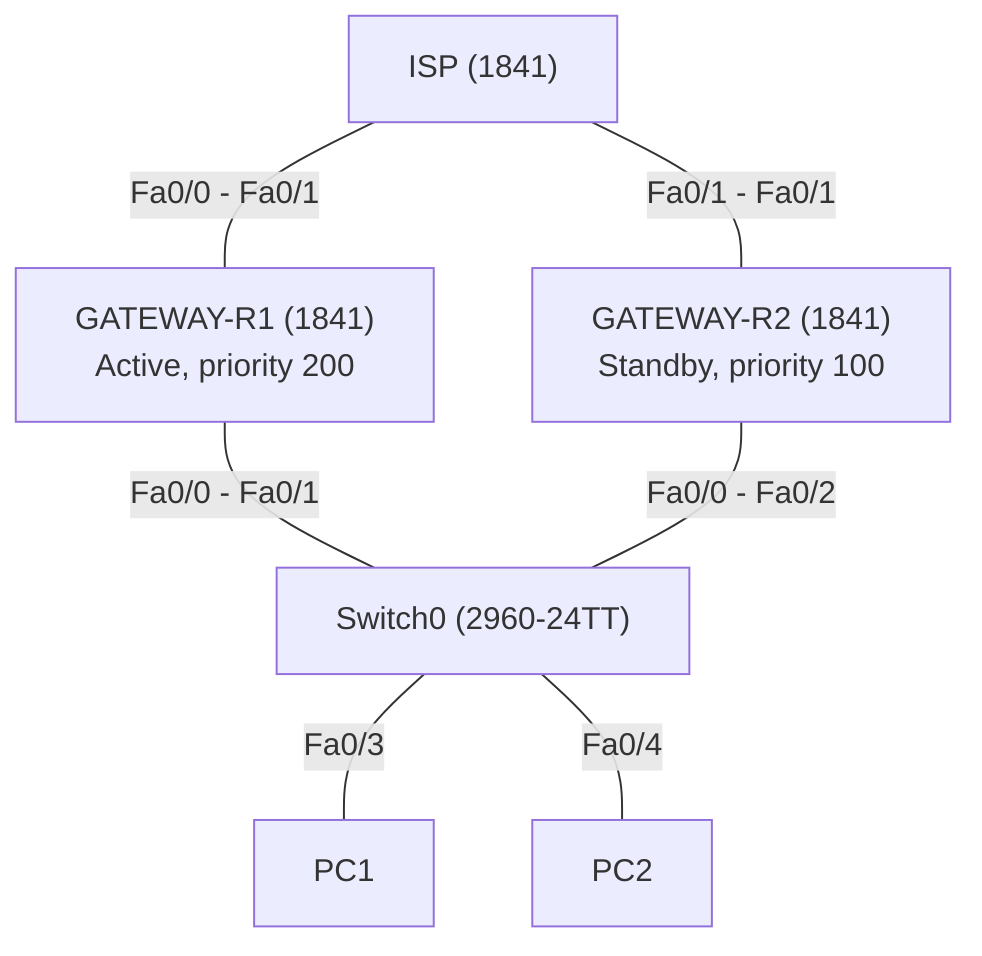
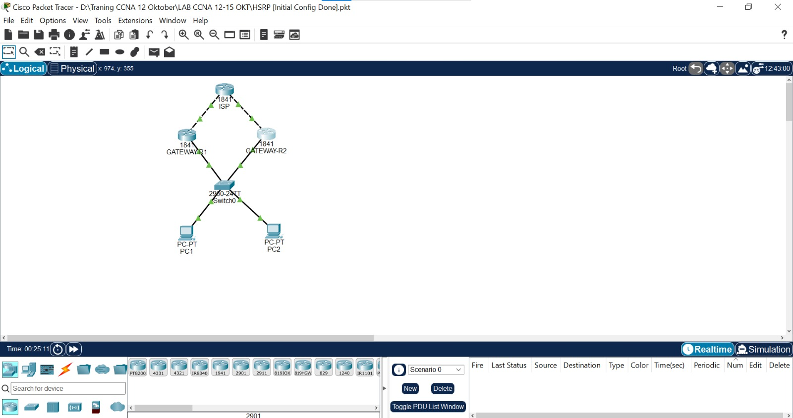
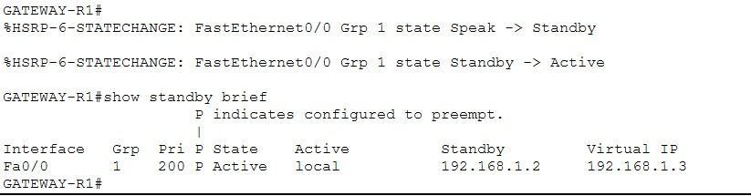
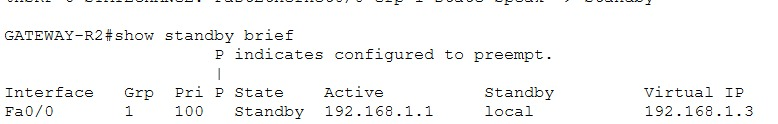
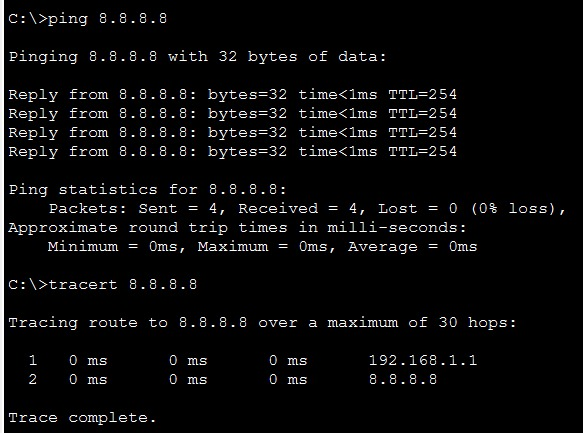
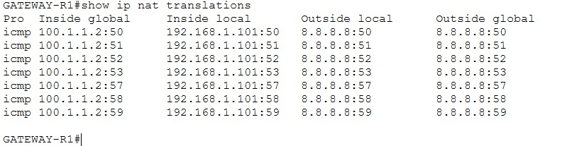
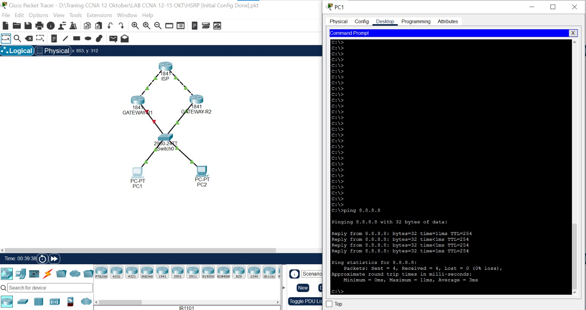
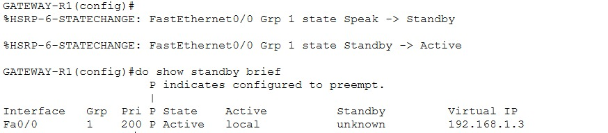

# Lab 01 - HSRP: Gateway Redundan dengan NAT Overload

> Platform: Cisco Packet Tracer · Training CCNA 200-301 (ID-Networkers), 12-15 Oktober 2026
> File lab: `HSRP [Initial Config Done].pkt`

## 1. Tujuan

Membuat dua router gateway yang berbagi satu **IP virtual** sehingga PC tetap punya jalan keluar ke internet walaupun salah satu router mati. Keduanya juga menjalankan **NAT overload (PAT)** agar seluruh PC di LAN privat bisa mengakses internet.

## 2. Topologi





## 3. Tabel alamat

| Perangkat | Interface | Alamat | Keterangan |
| --- | --- | --- | --- |
| GATEWAY-R1 | Fa0/0 | 192.168.1.1/24 | Sisi LAN (NAT inside) |
| GATEWAY-R1 | Fa0/1 | DHCP dari ISP (100.1.1.2) | Sisi ISP (NAT outside) |
| GATEWAY-R2 | Fa0/0 | 192.168.1.2/24 | Sisi LAN (NAT inside) |
| GATEWAY-R2 | Fa0/1 | DHCP dari ISP | Sisi ISP (NAT outside) |
| HSRP grup 1 | - | **192.168.1.3** | IP virtual, dipakai sebagai default gateway PC |

## 4. Konfigurasi

Konfigurasi lengkap ada di folder [`configs/`](configs/):

- [`GATEWAY-R1.txt`](configs/GATEWAY-R1.txt)
- [`GATEWAY-R2.txt`](configs/GATEWAY-R2.txt)

Perintah inti HSRP:

```
! R1 (Active)
interface FastEthernet0/0
 standby 1 ip 192.168.1.3
 standby 1 priority 200
 standby 1 preempt

! R2 (Standby)
interface FastEthernet0/0
 standby 1 ip 192.168.1.3
```

## 5. Penjelasan

| Perintah | Fungsi |
| --- | --- |
| `standby 1 ip 192.168.1.3` | Membuat grup HSRP 1 dengan IP virtual. Harus sama di kedua router |
| `standby 1 priority 200` | Priority lebih tinggi dari default 100, sehingga R1 menjadi Active |
| `standby 1 preempt` | R1 merebut kembali peran Active setelah pulih |
| `ip nat inside` / `ip nat outside` | Menandai sisi LAN dan sisi ISP untuk NAT |
| `access-list 77 permit 192.168.1.0 0.0.0.255` | Menentukan network yang boleh di-NAT |
| `ip nat inside source list 77 interface f0/1 overload` | PAT: banyak PC berbagi IP interface f0/1 |
| `ip route 0.0.0.0 0.0.0.0 <gateway ISP>` | Default route ke ISP |

## 6. Verifikasi

**R1 menjadi Active** (priority 200 + preempt). Virtual IP 192.168.1.3.



**R2 menjadi Standby.**



**PC bisa mengakses internet lewat gateway virtual.** Hop pertama pada tracert adalah router Active.



**NAT overload bekerja.** Alamat privat PC diterjemahkan ke IP interface ISP.



**Uji failover.** Interface Fa0/0 R1 dimatikan, R2 mengambil alih menjadi Active, dan PC tetap bisa ping.




**Failback.** Setelah R1 dihidupkan lagi, R1 kembali Active karena `preempt`.



## 7. Masalah dan solusi

| Masalah | Penyebab | Solusi |
| --- | --- | --- |
| IP bentrok di LAN | R2 sempat diberi 192.168.1.1, sama dengan R1 | Ganti ke 192.168.1.2. IP interface harus unik, hanya IP virtual yang dibagi |
| Perintah ditolak (`% Invalid input`) | Salah ketik `priorty` dan `stanby` | Ketik ulang `standby 1 priority 200` dan `standby 1 preempt` |

## 8. Yang dipelajari

- HSRP adalah protokol milik Cisco (Active dan Standby). Alternatifnya VRRP (standar IEEE) dan GLBP (bisa load balancing)
- Preempt diperlukan agar router berpriority tinggi mengambil kembali peran Active
- NAT overload dan default route harus ada di kedua gateway agar failover benar-benar tetap terhubung ke internet

## 9. Pengembangan lanjutan

- HSRP dengan `track` agar priority turun saat jalur ke ISP putus
- HSRP di MLS pada lab Jakarta
