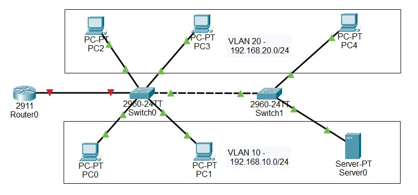
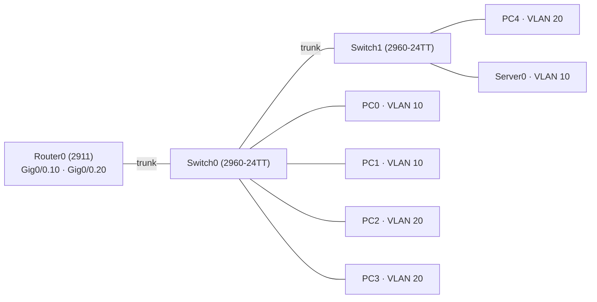
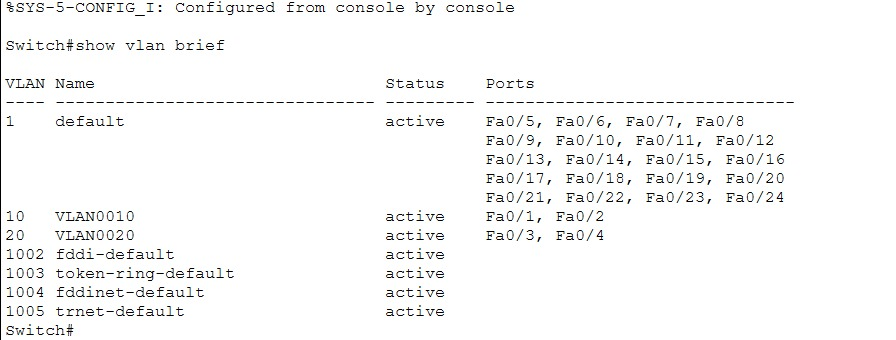
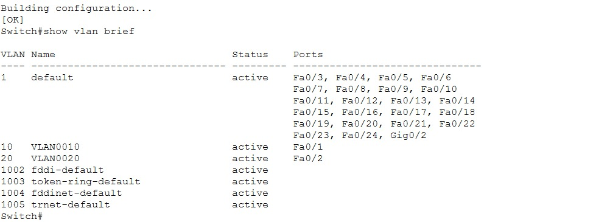
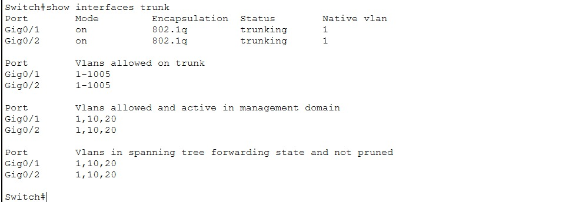
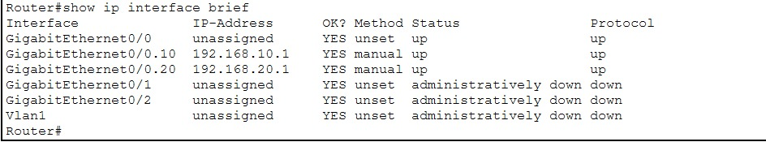
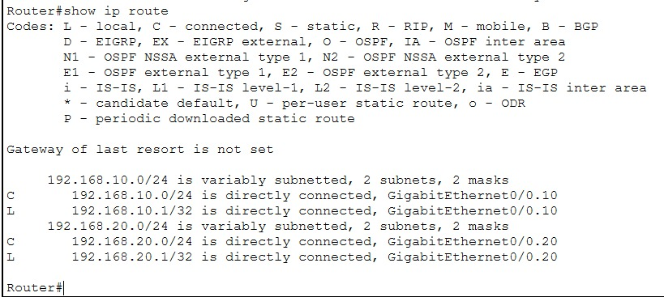
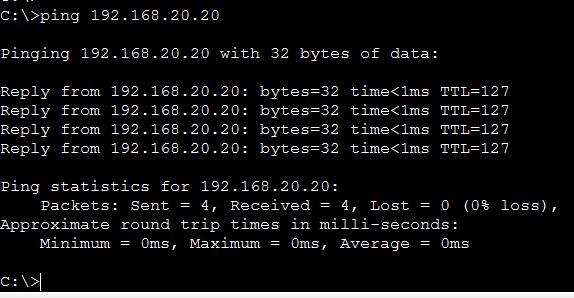
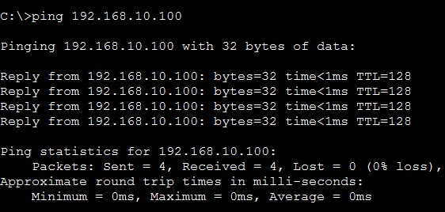
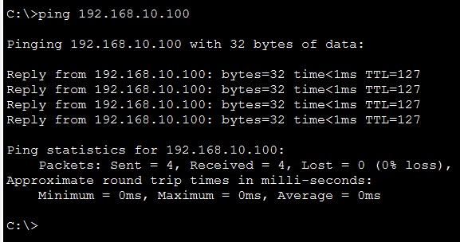

# Lab 02 - InterVLAN Routing dengan Router on a Stick

> Platform: Cisco Packet Tracer · Training CCNA 200-301 (ID-Networkers)
> File lab: `InterVLAN-Router.pkt`

## 1. Tujuan

Perangkat di VLAN berbeda berada di network berbeda, sehingga tidak bisa saling berkomunikasi tanpa perangkat Layer 3. Lab ini membuat dua VLAN pada dua switch, menghubungkannya dengan trunk, lalu mengaktifkan routing antar VLAN memakai **router on a stick**: satu interface router yang dipecah menjadi subinterface per VLAN.

## 2. Topologi





## 3. Tabel VLAN dan alamat

| VLAN | Network | Gateway (subinterface router) | Host |
| --- | --- | --- | --- |
| 10 | 192.168.10.0/24 | 192.168.10.1 (Gig0/0.10) | PC0, PC1, Server0 |
| 20 | 192.168.20.0/24 | 192.168.20.1 (Gig0/0.20) | PC2, PC3, PC4 |

### IP host

| Perangkat | VLAN | IP address | Subnet mask | Default gateway |
| --- | --- | --- | --- | --- |
| PC0 | 10 | 192.168.10.10 | 255.255.255.0 | 192.168.10.1 |
| PC1 | 10 | 192.168.10.11 | 255.255.255.0 | 192.168.10.1 |
| Server0 | 10 | 192.168.10.100 | 255.255.255.0 | 192.168.10.1 |
| PC2 | 20 | 192.168.20.20 | 255.255.255.0 | 192.168.20.1 |
| PC3 | 20 | 192.168.20.21 | 255.255.255.0 | 192.168.20.1 |
| PC4 | 20 | 192.168.20.22 | 255.255.255.0 | 192.168.20.1 |

Default gateway tiap host diisi IP subinterface VLAN-nya. Daftar yang sama ada di [`configs/IP-hosts.txt`](configs/IP-hosts.txt).

## 4. Pemetaan port

| Perangkat | Port | Terhubung ke | Mode |
| --- | --- | --- | --- |
| Router0 | Gig0/0 | Switch0 Gig0/1 | Induk subinterface |
| Switch0 | Gig0/1 | Router0 Gig0/0 | Trunk |
| Switch0 | Gig0/2 | Switch1 Gig0/1 | Trunk |
| Switch0 | Fa0/1 - Fa0/2 | PC0, PC1 | Access VLAN 10 |
| Switch0 | Fa0/3 - Fa0/4 | PC2, PC3 | Access VLAN 20 |
| Switch1 | Gig0/1 | Switch0 Gig0/2 | Trunk |
| Switch1 | Fa0/1 | Server0 | Access VLAN 10 |
| Switch1 | Fa0/2 | PC4 | Access VLAN 20 |

## 5. Langkah pengerjaan

1. Buat VLAN 10 dan 20 di Switch0 dan Switch1
2. Jadikan link Switch0-Router0 dan Switch0-Switch1 sebagai trunk
3. Pasang port host sebagai access port sesuai VLAN-nya
4. Konfigurasi subinterface pada Router0
5. Isi IP, mask, dan gateway di semua host
6. Uji ping dalam VLAN, antar VLAN, dan lintas switch

## 6. Konfigurasi

Konfigurasi lengkap per perangkat ada di folder [`configs/`](configs/):

- [`Router0.txt`](configs/Router0.txt)
- [`Switch0.txt`](configs/Switch0.txt)
- [`Switch1.txt`](configs/Switch1.txt)
- [`IP-hosts.txt`](configs/IP-hosts.txt)

Perintah inti pada router:

```
interface gig0/0
 no shutdown
interface gig0/0.10
 encapsulation dot1q 10
 ip address 192.168.10.1 255.255.255.0
interface gig0/0.20
 encapsulation dot1q 20
 ip address 192.168.20.1 255.255.255.0
```

## 7. Penjelasan

| Perintah | Fungsi |
| --- | --- |
| `vlan 10` / `vlan 20` | Membuat VLAN di database switch. VLAN harus dibuat di **setiap** switch |
| `switchport mode trunk` | Membuat link membawa banyak VLAN dengan tag 802.1Q |
| `switchport mode access` + `switchport access vlan 10` | Menjadikan port host anggota VLAN 10 |
| `interface gig0/0` + `no shutdown` | Menghidupkan interface fisik. Subinterface tidak aktif jika induknya shutdown |
| `interface gig0/0.10` | Membuat subinterface logis untuk VLAN 10 |
| `encapsulation dot1q 10` | Subinterface memproses frame ber-tag VLAN 10 |
| `ip address 192.168.10.1 255.255.255.0` | IP gateway VLAN 10 |

## 8. Verifikasi

**IP host.** Hasil `ipconfig` (atau IP Configuration) pada host VLAN 10 dan VLAN 20.


**VLAN di kedua switch.** Port host berada di VLAN yang benar.





**Trunk aktif.**



**Subinterface router berstatus up/up dan route connected untuk kedua VLAN.**





**Ping antar VLAN**: `ping 192.168.20.20` dari PC0 (VLAN 10) ke PC2 (VLAN 20). TTL=127 menandakan paket melewati satu router. Request pertama bisa timed out karena ARP masih belajar, ulangi sampai 4 balasan.



**Ping antar switch dalam satu VLAN**: `ping 192.168.10.100` dari PC0 ke Server0. Tidak melewati router, jadi TTL=128.



**Ping antar VLAN lintas switch**: `ping 192.168.10.100` dari PC4 (VLAN 20) ke Server0 (VLAN 10).



## 9. Troubleshooting yang perlu dicek

| Gejala | Penyebab umum | Pengecekan |
| --- | --- | --- |
| Ping antar VLAN gagal | Link router ke switch belum trunk, atau `no shutdown` belum diberikan | `show interfaces trunk`, `show ip interface brief` |
| Subinterface down | Interface induk (`gig0/0`) masih shutdown | `no shutdown` pada `gig0/0` |
| Host satu VLAN beda switch tidak terhubung | VLAN belum dibuat di salah satu switch, atau trunk antar switch belum aktif | `show vlan brief` di kedua switch |
| Request pertama ping timed out, sisanya balas | ARP belum terisi, wajar pada ping pertama | Ulangi ping |
| Ping VLAN sama berhasil, VLAN beda gagal | Default gateway host salah | Pastikan gateway sesuai tabel alamat |

## 10. Yang dipelajari

- Router on a stick hemat kabel, tetapi satu link trunk menjadi bottleneck. Di jaringan kantor biasanya diganti multilayer switch (lihat Lab 07)
- VLAN tidak tersalin otomatis antar switch, harus dibuat di masing-masing
- TTL 127 pada ping membuktikan satu hop router sudah dilewati

## 11. Pengembangan lanjutan

- Tambahkan DHCP server di router untuk tiap VLAN
- Tambahkan NAT agar VLAN bisa ke internet
- Pindahkan management switch ke VLAN khusus

## 12. Ringkasan hasil uji

| Uji | Dari | Ke | Hasil yang diharapkan |
| --- | --- | --- | --- |
| Satu VLAN, satu switch | PC0 | PC1 (192.168.10.11) | 0% loss, TTL=128 |
| Satu VLAN, beda switch | PC0 | Server0 (192.168.10.100) | 0% loss, TTL=128 |
| Antar VLAN | PC0 | PC2 (192.168.20.20) | 0% loss, TTL=127 |
| Antar VLAN, lintas switch | PC4 | Server0 (192.168.10.100) | 0% loss, TTL=127 |
| Ke gateway | PC2 | 192.168.20.1 | 0% loss |
