# Lab 03 - Link Aggregation: EtherChannel LACP Layer 2 dan Layer 3

> Platform: Cisco Packet Tracer · Training CCNA 200-301 (ID-Networkers)
> File lab: `Link-Aggregation.pkt`

## 1. Tujuan

Menggabungkan dua link fisik menjadi **satu link logis (EtherChannel)** dengan protokol **LACP** pada dua jenis bundel:

- **Layer 2** antara MLS1 dan MLS2: bundel bekerja sebagai satu trunk
- **Layer 3** antara MLS2 dan MLS3: bundel bekerja sebagai satu routed port yang memiliki alamat IP

Hasilnya bandwidth bertambah, ada redundansi jika satu kabel putus, dan STP tidak memblokir salah satu link karena melihat satu link saja.

## 2. Topologi

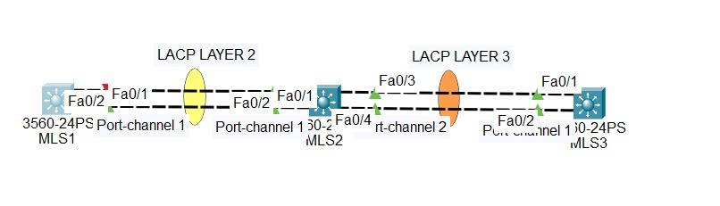

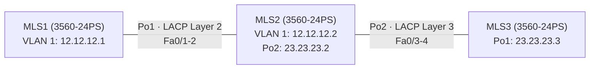

## 3. Tabel alamat

| Perangkat | Interface | IP address | Keterangan |
| --- | --- | --- | --- |
| MLS1 | VLAN 1 | 12.12.12.1/24 | Melalui Po1 (Layer 2) |
| MLS2 | VLAN 1 | 12.12.12.2/24 | Melalui Po1 (Layer 2) |
| MLS2 | Port-channel 2 | 23.23.23.2/24 | Routed port (Layer 3) |
| MLS3 | Port-channel 1 | 23.23.23.3/24 | Routed port (Layer 3) |

## 4. Pemetaan port dan bundel

| Bundel | Jenis | Perangkat | Port anggota | Group | Mode LACP |
| --- | --- | --- | --- | --- | --- |
| Layer 2 | Trunk | MLS1 | Fa0/1 - Fa0/2 | 1 | Passive |
| Layer 2 | Trunk | MLS2 | Fa0/1 - Fa0/2 | 1 | Active |
| Layer 3 | Routed | MLS2 | Fa0/3 - Fa0/4 | 2 | Active |
| Layer 3 | Routed | MLS3 | Fa0/3 - Fa0/4 | 1 | Active |

Nomor group hanya berlaku lokal, tidak harus sama di kedua sisi.

## 5. Konsep singkat

| Protokol | Standar | Mode | Keterangan |
| --- | --- | --- | --- |
| LACP | Open standard | Active, Passive | Dipakai di lab ini |
| PAgP | Cisco | Desirable, Auto | Hanya antar perangkat Cisco |
| Static | - | On | Tanpa negosiasi, kurang fleksibel |

Bundel terbentuk jika kombinasinya Active-Active atau Active-Passive. Passive-Passive dan Auto-Auto tidak terbentuk. Pada lab Layer 2, MLS1 passive dan MLS2 active, sehingga bundel tetap terbentuk.

Syarat port anggota: jenis interface sama (FastEthernet tidak dicampur dengan GigabitEthernet), serta speed, duplex, VLAN, dan mode trunk sama. Satu bundel maksimal 8 port. Anggota harus sama-sama Layer 2 atau sama-sama Layer 3.

## 6. Konfigurasi

Konfigurasi lengkap per perangkat ada di folder [`configs/`](configs/):

- [`MLS1.txt`](configs/MLS1.txt)
- [`MLS2.txt`](configs/MLS2.txt)
- [`MLS3.txt`](configs/MLS3.txt)

Perintah inti Layer 2 (MLS2 sebagai contoh):

```
interface range fa0/1-2
 channel-group 1 mode active
interface port-channel 1
 switchport trunk encapsulation dot1q
 switchport mode trunk
```

Perintah inti Layer 3:

```
interface range fa0/3-4
 no switchport
 channel-group 2 mode active
interface port-channel 2
 ip address 23.23.23.2 255.255.255.0
 no shutdown
```

## 7. Penjelasan

| Perintah | Fungsi |
| --- | --- |
| `channel-group 1 mode active` | Memasukkan port ke bundel 1 memakai LACP active. `passive` menunggu negosiasi, minimal satu sisi harus active |
| `interface port-channel 1` | Interface logis bundel. Pengaturan trunk atau IP dipasang di sini, bukan di port anggota |
| `switchport trunk encapsulation dot1q` | Diperlukan pada switch Layer 3 yang mendukung ISL dan dot1q |
| `no switchport` | Mengubah port anggota menjadi routed port (Layer 3). Dilakukan sebelum `channel-group` |
| `ip address ...` pada port-channel | IP bundel Layer 3 |
| `ip routing` | Mengaktifkan routing Layer 3 di switch |
| `ip route 23.23.23.0 255.255.255.0 12.12.12.2` | Static route di MLS1 agar jaringan di belakang MLS2 terjangkau |

Urutan pengerjaan: konfigurasikan `channel-group` terlebih dahulu, baru atur `port-channel`. Dengan begitu tidak terjadi loop sementara sebelum bundel terbentuk.

## 8. Verifikasi

**Layer 2 di MLS1.** Po1 berflag **SU** (S = Layer 2, U = in use), protokol LACP, kedua port berflag **P**.

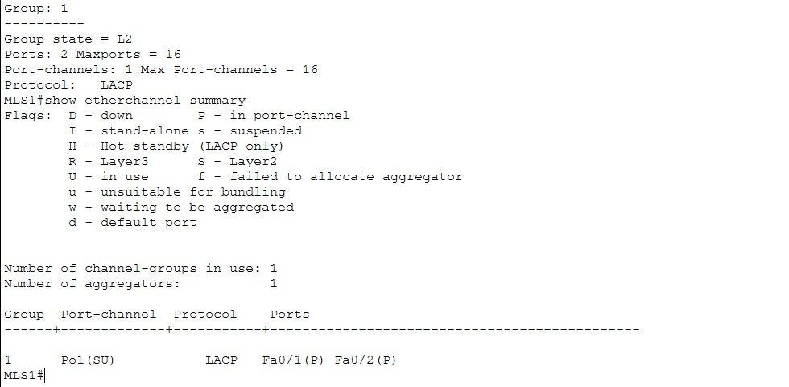

**MLS2 memiliki dua bundel:** Po1 (SU) dan Po2 (**RU**, R = Layer 3).

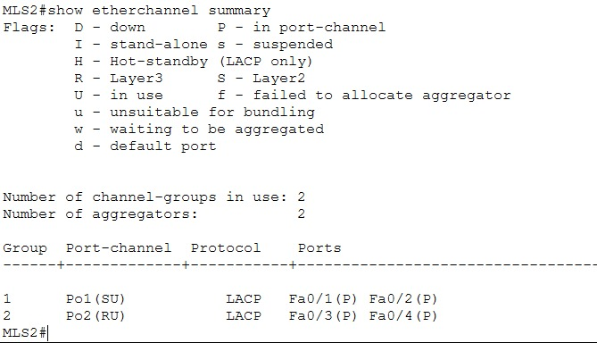

**Layer 3 di MLS3.**

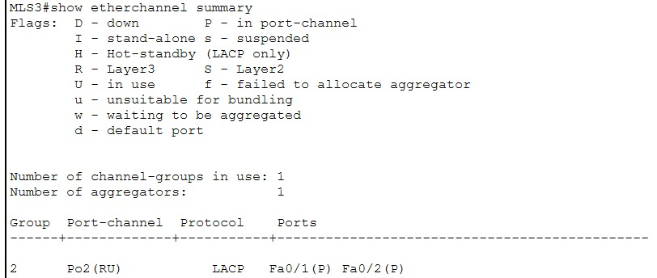

**Bandwidth gabungan.** Pada Po1 nilai BW menjadi gabungan dua link (2 x 100 Mbps).

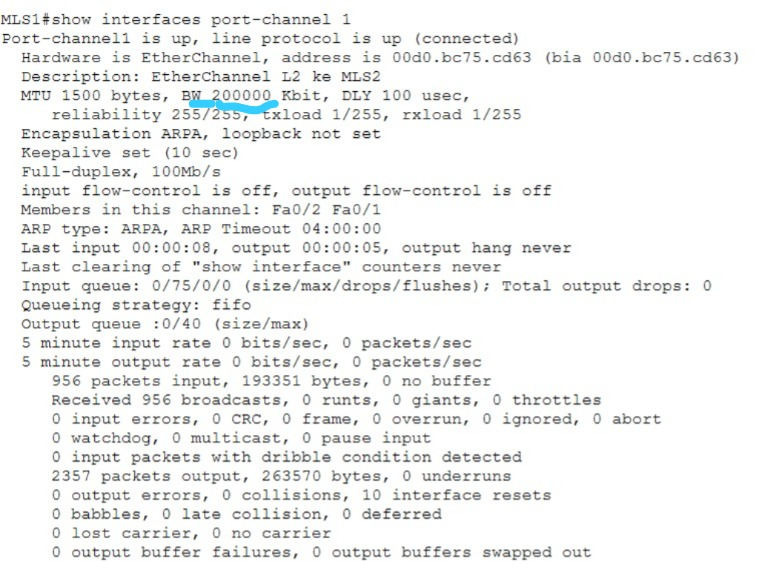

**IP pada bundel Layer 3.**

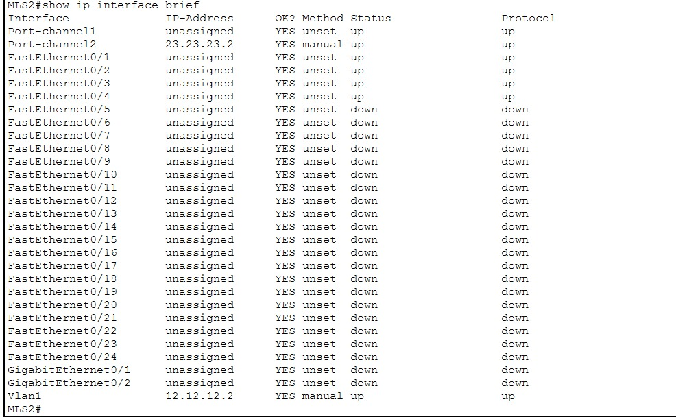

**Konektivitas.** MLS1 ke MLS2 (Layer 2), lalu MLS1 ke MLS3 (melewati MLS2).

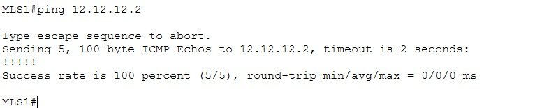

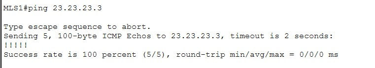

**Uji redundansi.** Satu link anggota dimatikan (`shutdown` pada Fa0/2 di MLS1). Po1 tetap SU dengan satu port aktif, dan ping tetap berhasil.

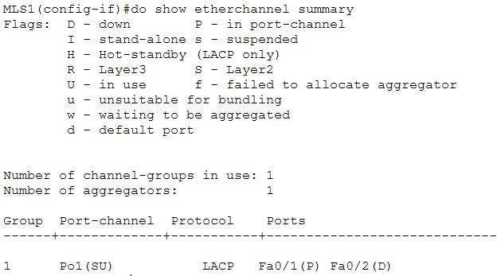

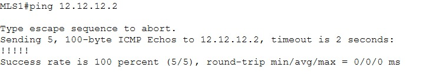

## 9. Troubleshooting

| Gejala | Kemungkinan penyebab | Pengecekan |
| --- | --- | --- |
| Flag `s` (suspended) atau `I` | Pengaturan port anggota tidak sama (speed, duplex, VLAN, mode) | Samakan konfigurasi semua port anggota |
| Bundel tidak terbentuk | Mode tidak cocok (Passive-Passive, atau LACP dengan PAgP) | `show etherchannel summary` di kedua sisi |
| Layer 3 tidak mendapat IP | Port belum `no switchport` sebelum `channel-group`, atau IP dipasang di port anggota | Pasang IP di `port-channel` |
| Ping ke MLS3 gagal dari MLS1 | `ip routing` atau static route belum ada | `show ip route` |
| Port `err-disabled` | Konfigurasi tidak konsisten di kedua sisi | Cek `channel-group` di kedua perangkat |

## 10. Yang dipelajari

- EtherChannel menggabungkan link fisik menjadi satu link logis, sehingga STP tidak memblokir link anggota
- Layer 2 EtherChannel berperan sebagai trunk, Layer 3 EtherChannel sebagai routed port ber-IP
- Satu aliran (pasangan IP yang sama) tetap lewat satu link. Bandwidth gabungan terasa saat banyak aliran
- Flag SU = Layer 2 in use, RU = Layer 3 in use, P = port tergabung

## 11. Pengembangan lanjutan

- Load balancing dengan `port-channel load-balance src-dst-ip`
- Membandingkan PAgP (Desirable/Auto) dan Static (On)
- Routing dinamis (OSPF) di atas EtherChannel Layer 3
