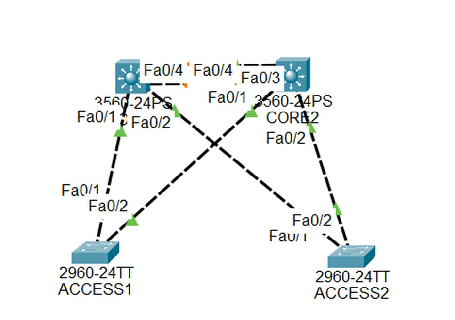
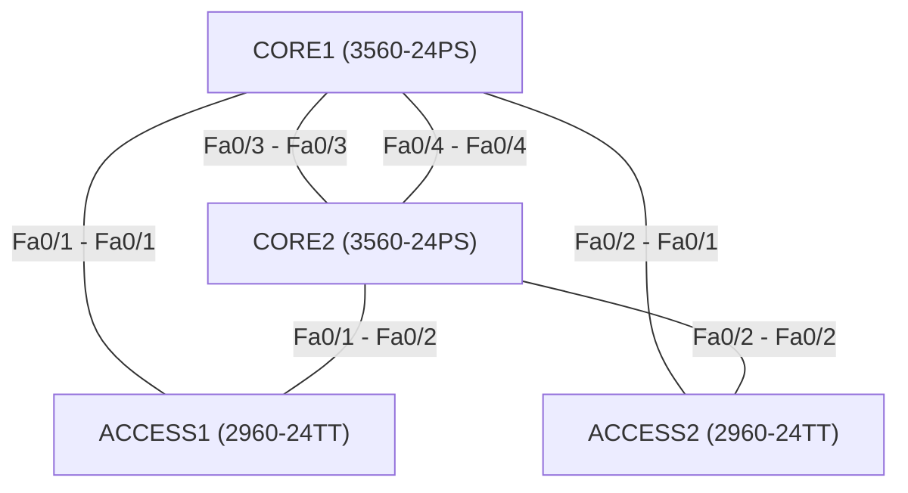
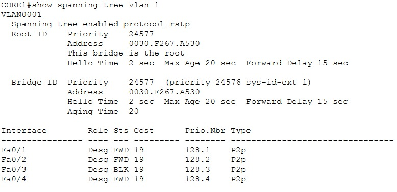
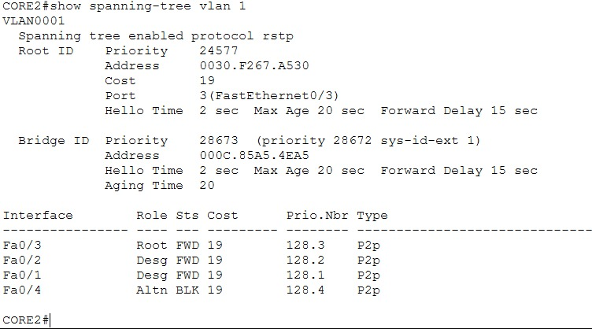
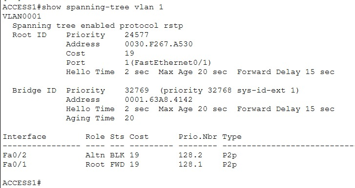
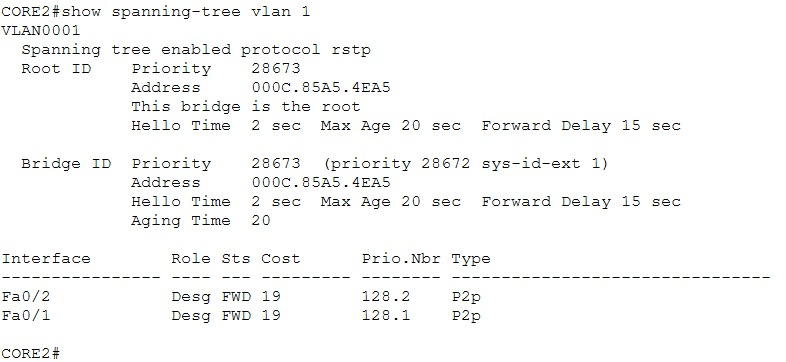
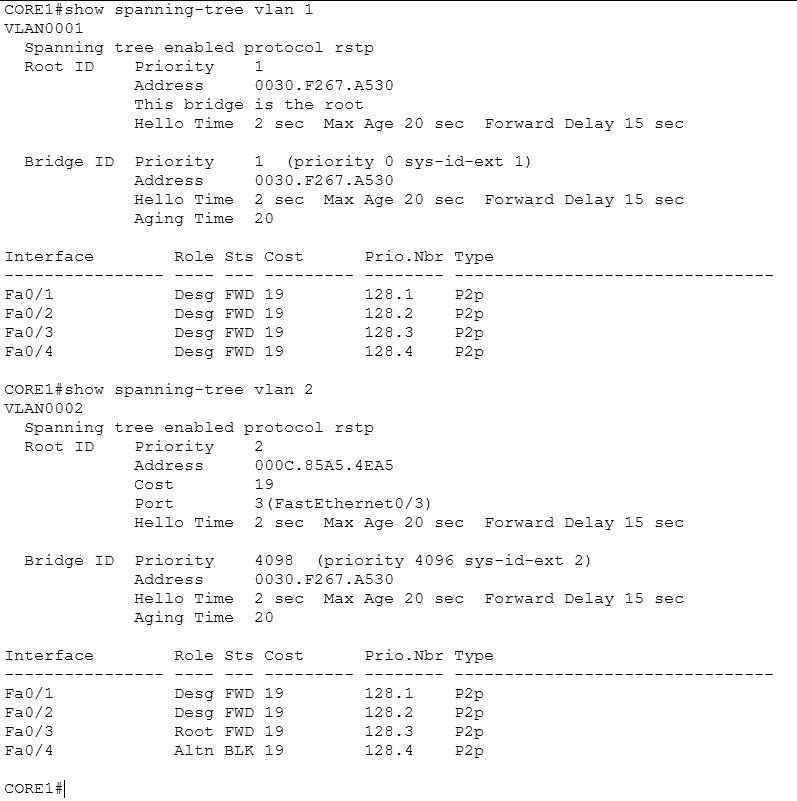
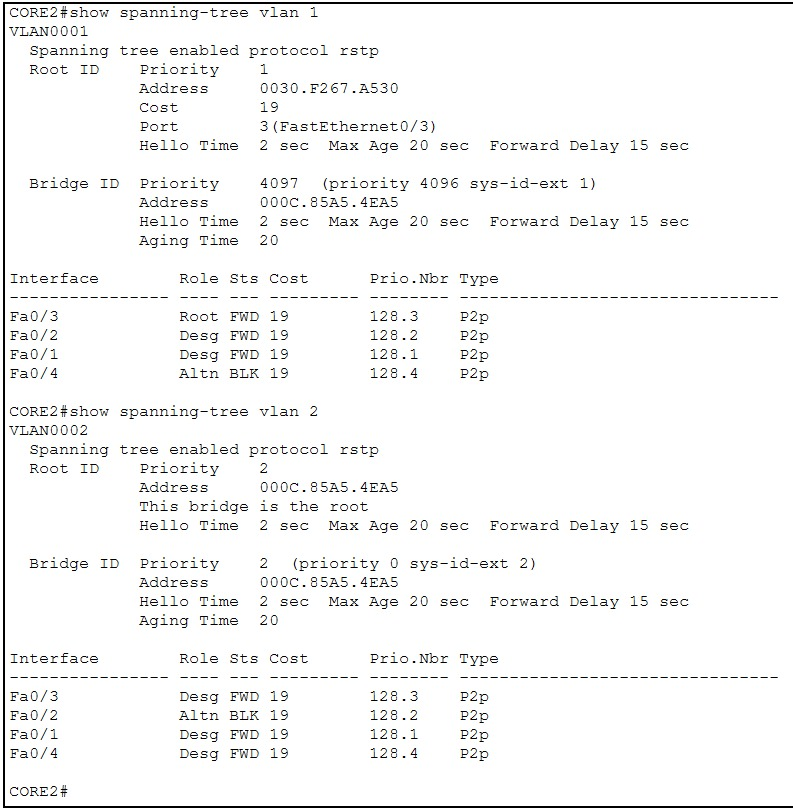
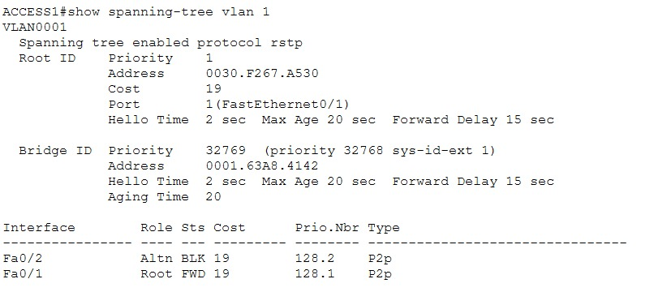
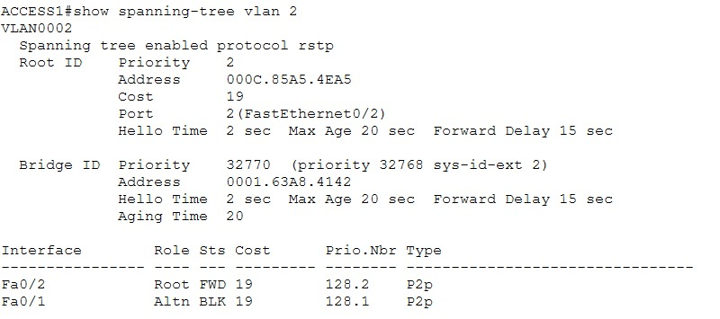

# Lab 04 - STP: Rapid PVST+, Root Bridge, dan Load Balancing per VLAN

> Platform: Cisco Packet Tracer · Training CCNA 200-301 (ID-Networkers)
> File lab: `STP.pkt`

## 1. Tujuan

Jalur cadangan antar switch (redundansi) tanpa pengaturan akan membuat **loop** dan **broadcast storm**. Lab ini memakai **Spanning Tree Protocol** untuk memutus loop secara logis:

- **Skenario 1:** satu root bridge untuk semua VLAN (CORE1 root primary, CORE2 root secondary)
- **Skenario 2:** root bridge berbeda per VLAN supaya semua link terpakai bergantian (load balancing)

## 2. Topologi





## 3. Pemetaan port

| Perangkat | Port | Terhubung ke | Mode |
| --- | --- | --- | --- |
| CORE1 | Fa0/1 | ACCESS1 Fa0/1 | Trunk |
| CORE1 | Fa0/2 | ACCESS2 Fa0/1 | Trunk |
| CORE1 | Fa0/3 - Fa0/4 | CORE2 Fa0/3 - Fa0/4 | Trunk (dua link antar core) |
| CORE2 | Fa0/1 | ACCESS1 Fa0/2 | Trunk |
| CORE2 | Fa0/2 | ACCESS2 Fa0/2 | Trunk |
| ACCESS1 | Fa0/1 - Fa0/2 | CORE1, CORE2 | Trunk |
| ACCESS2 | Fa0/1 - Fa0/2 | CORE1, CORE2 | Trunk |

## 4. Konsep singkat

| Istilah | Penjelasan |
| --- | --- |
| BPDU | Frame yang dipakai antar switch untuk bertukar informasi STP |
| Bridge ID | Switch Priority (default 32768) + MAC address. Ditambah VLAN ID sebagai extended system ID |
| Root Bridge | Switch dengan Bridge ID terkecil. Semua port-nya designated (forwarding) |
| Root Port | Port non-root bridge dengan cost terkecil menuju root. Forwarding |
| Designated Port | Port yang menjauhi root, satu per segmen. Forwarding |
| Alternate Port | Jalur cadangan menuju root. Diblokir (blocking atau discarding) untuk mencegah loop |

Cost link: 100 Mbps = 19, 1 Gbps = 4.

| Varian | Standar | Instance | Konvergensi |
| --- | --- | --- | --- |
| STP | 802.1D | Satu untuk semua VLAN | Lambat |
| PVST+ | Cisco | Satu per VLAN | Lambat (default switch Cisco) |
| RSTP | 802.1w | Satu untuk semua VLAN | Cepat |
| **Rapid PVST+** | Cisco | Satu per VLAN | Cepat, dipakai di lab ini |

## 5. Langkah pengerjaan

1. Buat VLAN 2 di semua switch (VLAN 1 sudah ada secara default)
2. Aktifkan trunk di semua link antar switch
3. Ganti mode STP ke `rapid-pvst` di **semua** switch
4. Skenario 1: tetapkan CORE1 sebagai root primary dan CORE2 sebagai root secondary
5. Verifikasi dan uji failover
6. Skenario 2: bagi root per VLAN dengan priority, lalu verifikasi ulang

## 6. Konfigurasi

Konfigurasi per perangkat ada di folder [`configs/`](configs/):

- [`CORE1.txt`](configs/CORE1.txt) · [`CORE2.txt`](configs/CORE2.txt)
- [`ACCESS1.txt`](configs/ACCESS1.txt) · [`ACCESS2.txt`](configs/ACCESS2.txt)
- [`skenario-2-load-balancing.txt`](configs/skenario-2-load-balancing.txt)

Perintah inti skenario 1:

```
! CORE1
spanning-tree mode rapid-pvst
spanning-tree vlan 1 root primary

! CORE2
spanning-tree mode rapid-pvst
spanning-tree vlan 1 root secondary
```

Perintah inti skenario 2:

```
! CORE1: root VLAN 1, cadangan VLAN 2
spanning-tree vlan 1 priority 0
spanning-tree vlan 2 priority 4096

! CORE2: root VLAN 2, cadangan VLAN 1
spanning-tree vlan 2 priority 0
spanning-tree vlan 1 priority 4096
```

## 7. Penjelasan

| Perintah | Fungsi |
| --- | --- |
| `spanning-tree mode rapid-pvst` | Mengganti PVST+ ke Rapid PVST+ (802.1w) yang konvergen cepat. Semua switch harus memakai mode yang sama |
| `spanning-tree vlan 1 root primary` | Otomatis menurunkan priority (24576) agar switch menjadi root |
| `spanning-tree vlan 1 root secondary` | Priority 28672, menjadi cadangan jika root mati |
| `spanning-tree vlan 1 priority 0` | Priority terendah, pasti menjadi root VLAN tersebut |
| `spanning-tree vlan 2 priority 4096` | Lebih besar dari 0 tetapi jauh di bawah 32768, jadi menjadi cadangan |
| `switchport trunk encapsulation dot1q` | Diperlukan di 3560 (mendukung ISL dan dot1q). Tidak ada di 2960 |
| `vlan 2` | VLAN harus ada di semua switch agar punya instance STP dan bisa lewat trunk |

Pada output `show spanning-tree vlan 1`, priority Root ID bernilai sekitar 24577 di skenario 1 (24576 ditambah VLAN ID 1). Switch lain memakai 32769 (32768 + 1).

## 8. Verifikasi

### Skenario 1: satu root untuk semua VLAN

**CORE1 menjadi root bridge.** Tertulis "This bridge is the root", dan semua port-nya Desg (designated).



**CORE2 non-root.** Ada root port menuju CORE1, dan salah satu link antar core berstatus Altn (blocking atau discarding).



**ACCESS1 non-root.** Satu uplink menjadi Root, uplink lainnya Altn.



**Uji failover.** CORE1 dimatikan (semua port di-`shutdown`), CORE2 mengambil alih sebagai root bridge.



### Skenario 2: root berbeda per VLAN

**CORE1** menjadi root VLAN 1 dan cadangan VLAN 2.



**CORE2** menjadi root VLAN 2 dan cadangan VLAN 1.



**Port yang diblokir berbeda per VLAN.** Pada ACCESS1, uplink Altn untuk VLAN 1 tidak sama dengan VLAN 2, sehingga kedua uplink dipakai bergantian.





## 9. Troubleshooting

| Gejala | Kemungkinan penyebab | Pengecekan |
| --- | --- | --- |
| Root bridge bukan switch yang diinginkan | Priority belum diatur atau mode STP berbeda antar switch | `show spanning-tree vlan 1` di tiap switch |
| VLAN 2 tidak muncul di `show spanning-tree` | VLAN 2 belum dibuat di switch itu | `show vlan brief`, buat VLAN 2 |
| Tidak ada port Altn | Link belum menjadi trunk, atau hanya satu jalur aktif | `show interfaces trunk` |
| Hasil STP aneh setelah banyak perubahan | State lama belum dihitung ulang | `write` lalu `reload` |

## 10. Yang dipelajari

- STP memutus loop dengan memblokir port tertentu, bukan memutus kabel. Port itu aktif kembali jika jalur utama mati
- Root bridge dipilih dari Bridge ID terkecil, jadi peran root sebaiknya ditetapkan sendiri, bukan diserahkan ke MAC address
- Dengan root berbeda per VLAN, tidak ada link yang menganggur seperti pada satu root untuk semua VLAN
- VLAN harus ada di semua switch agar punya instance STP dan bisa lewat trunk

## 11. Pengembangan lanjutan

- `spanning-tree portfast` di port ke end device (jangan di port antar switch)
- `spanning-tree bpduguard enable` agar port portfast mati jika menerima BPDU
- `spanning-tree guard root` di port yang tidak boleh menjadi jalur menuju root baru
- `spanning-tree guard loop` untuk melindungi port alternate saat BPDU berhenti
- Menggabungkan dua link antar core dengan EtherChannel (lihat Lab 03)
