# Lab 05 - Wireless LAN Controller (WLC): CAPWAP, WLAN WPA2, dan DHCP

> Platform: Cisco Packet Tracer · Training CCNA 200-301 (ID-Networkers)
> File lab: `WLC.pkt`

## 1. Tujuan

Mengelola access point secara terpusat dengan **Wireless LAN Controller**. Dua lightweight AP mengambil IP dari DHCP, menemukan WLC, lalu bergabung lewat **CAPWAP**. Konfigurasi WLAN (SSID, VLAN, keamanan WPA2) cukup dibuat sekali di WLC, dan klien wireless mendapat IP dari VLAN yang dipetakan.

## 2. Topologi

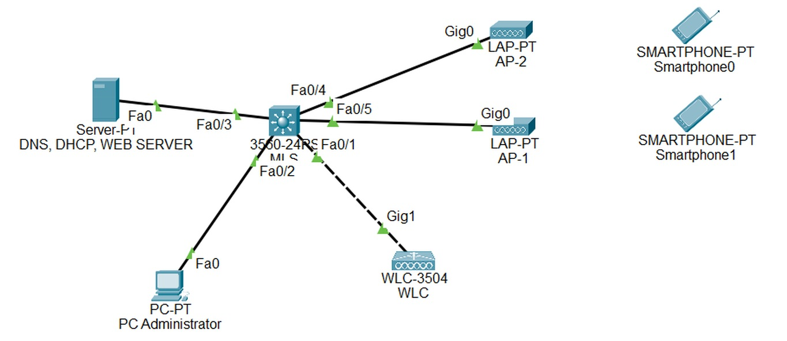

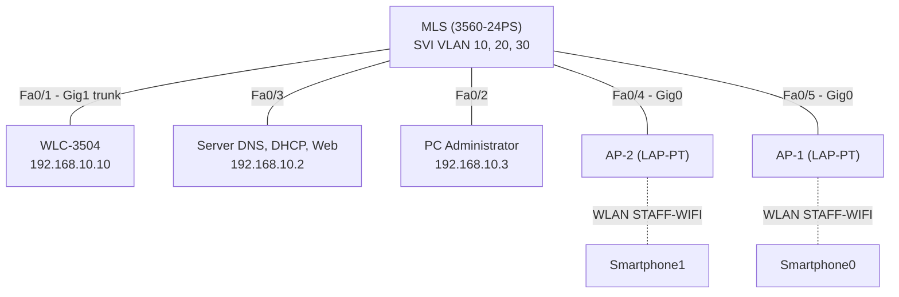

## 3. Rencana VLAN dan alamat

| VLAN | Nama | Network | Gateway (SVI MLS) | Fungsi |
| --- | --- | --- | --- | --- |
| 10 | MGMT | 192.168.10.0/24 | 192.168.10.1 | WLC, server, PC administrator |
| 20 | AP | 192.168.20.0/24 | 192.168.20.1 | Access point (DHCP) |
| 30 | CLIENT | 192.168.30.0/24 | 192.168.30.1 | Klien wireless (DHCP) |

| Perangkat | VLAN | IP address | Keterangan |
| --- | --- | --- | --- |
| Server | 10 | 192.168.10.2 | DNS, DHCP, Web |
| PC Administrator | 10 | 192.168.10.3 | Mengakses GUI WLC |
| WLC-3504 (management) | 10 | 192.168.10.10 | Alamat GUI dan CAPWAP |
| WLC interface `vlan30` | 30 | 192.168.30.2 | Dynamic interface klien |
| AP-1, AP-2 | 20 | DHCP 192.168.20.x | Dari pool AP-POOL |
| Smartphone0, Smartphone1 | 30 | DHCP 192.168.30.x | Dari pool CLIENT-POOL |

## 4. Pemetaan port MLS

| Port | Terhubung ke | Mode |
| --- | --- | --- |
| Fa0/1 | WLC Gig1 | Trunk (native VLAN 10, allowed VLAN 10 dan 30) |
| Fa0/2 | PC Administrator | Access VLAN 10 |
| Fa0/3 | Server | Access VLAN 10 |
| Fa0/4 | AP-2 Gig0 | Access VLAN 20 |
| Fa0/5 | AP-1 Gig0 | Access VLAN 20 |

## 5. Konsep singkat

| Model AP | Keterangan |
| --- | --- |
| Autonomous AP | Dikonfigurasi satu per satu, cocok untuk jumlah sedikit |
| Lightweight AP + WLC | Dikelola terpusat lewat tunnel **CAPWAP**. Dipakai di lab ini |
| Cloud-based | Dikelola dari cloud, misalnya Meraki |

| Model deployment WLC | Ciri |
| --- | --- |
| Unified | WLC terpusat, sampai 6000 AP |
| Cloud-based | WLC di cloud atau VM, sampai 3000 AP |
| Embedded | WLC menyatu di switch, kurang dari 200 AP |
| Cisco Mobility Express | WLC menyatu di AP, sampai 100 AP, cocok cabang kecil |

Keamanan wireless: autentikasi Open, PSK, atau 802.1X (EAP dengan RADIUS). Enkripsi WEP dan WPA (TKIP) sudah tidak aman, gunakan **WPA2 (AES)** atau WPA3. Satu SSID biasanya dipetakan ke satu VLAN.

## 6. Langkah pengerjaan

1. Konfigurasi MLS: VLAN, SVI, DHCP relay, trunk ke WLC, dan port access
2. Isi IP statis server, PC Administrator, dan management WLC
3. Aktifkan DHCP server dengan dua pool (AP dan klien)
4. Buka GUI WLC dari PC Administrator, buat interface `vlan30` dan WLAN `STAFF-WIFI`
5. Pastikan kedua AP terdaftar di WLC
6. Hubungkan smartphone ke SSID, lalu uji akses ke web server

## 7. Konfigurasi

Folder [`configs/`](configs/):

- [`MLS.txt`](configs/MLS.txt): konfigurasi CLI MLS
- [`IP-hosts.txt`](configs/IP-hosts.txt): IP statis perangkat
- [`DHCP-server.txt`](configs/DHCP-server.txt): pool DHCP di server
- [`WLC-langkah-GUI.txt`](configs/WLC-langkah-GUI.txt): langkah konfigurasi di GUI WLC

Perintah inti MLS:

```
ip routing
interface vlan 20
 ip address 192.168.20.1 255.255.255.0
 ip helper-address 192.168.10.2
interface fa0/1
 switchport trunk encapsulation dot1q
 switchport mode trunk
 switchport trunk native vlan 10
 switchport trunk allowed vlan 10,30
```

## 8. Penjelasan

| Konfigurasi | Fungsi |
| --- | --- |
| `ip helper-address 192.168.10.2` | DHCP relay: broadcast DHCP dari VLAN 20 dan 30 diteruskan ke server di VLAN 10 |
| Port AP di VLAN 20 | AP mendapat IP dari pool AP-POOL |
| Pool AP-POOL berisi WLC Controller IP | AP menemukan WLC lewat DHCP (setara option 43), lalu join lewat CAPWAP |
| Trunk Fa0/1 allowed VLAN 10 dan 30 | Management WLC (VLAN 10) dan klien wireless (VLAN 30) lewat satu kabel |
| Interface `vlan30` di WLC | Dynamic interface: tempat trafik klien keluar ke jaringan kabel |
| WLAN STAFF-WIFI dipetakan ke `vlan30` | Klien yang terhubung ke SSID ini mendapat IP 192.168.30.x |
| WPA2 PSK (AES) | Autentikasi dengan kata sandi bersama dan enkripsi AES |

## 9. Verifikasi

**Jaringan kabel.** VLAN 10, 20, 30 terbuat, SVI aktif, dan Fa0/1 berstatus trunk.

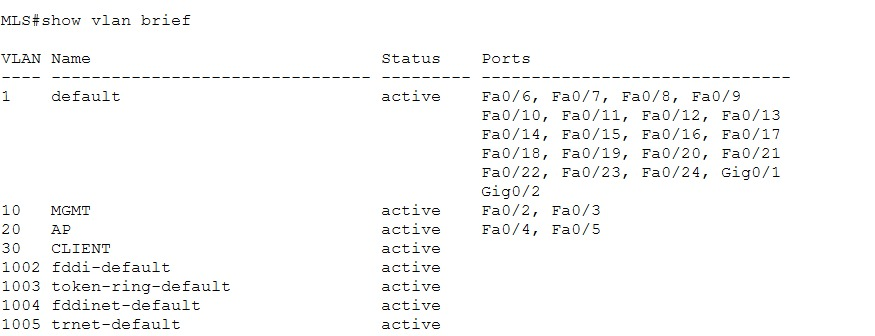

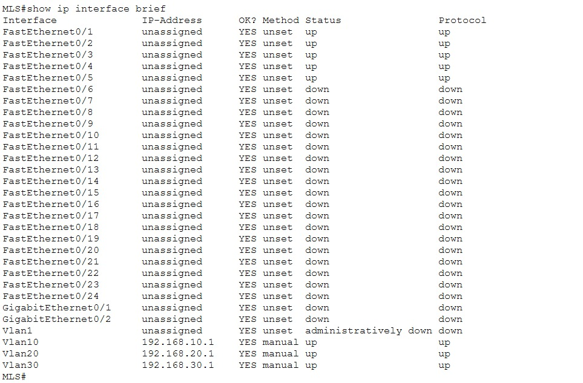

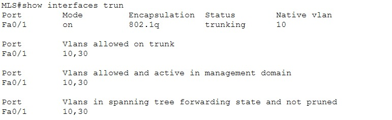

**DHCP server.** Pool AP-POOL dan CLIENT-POOL terdaftar.

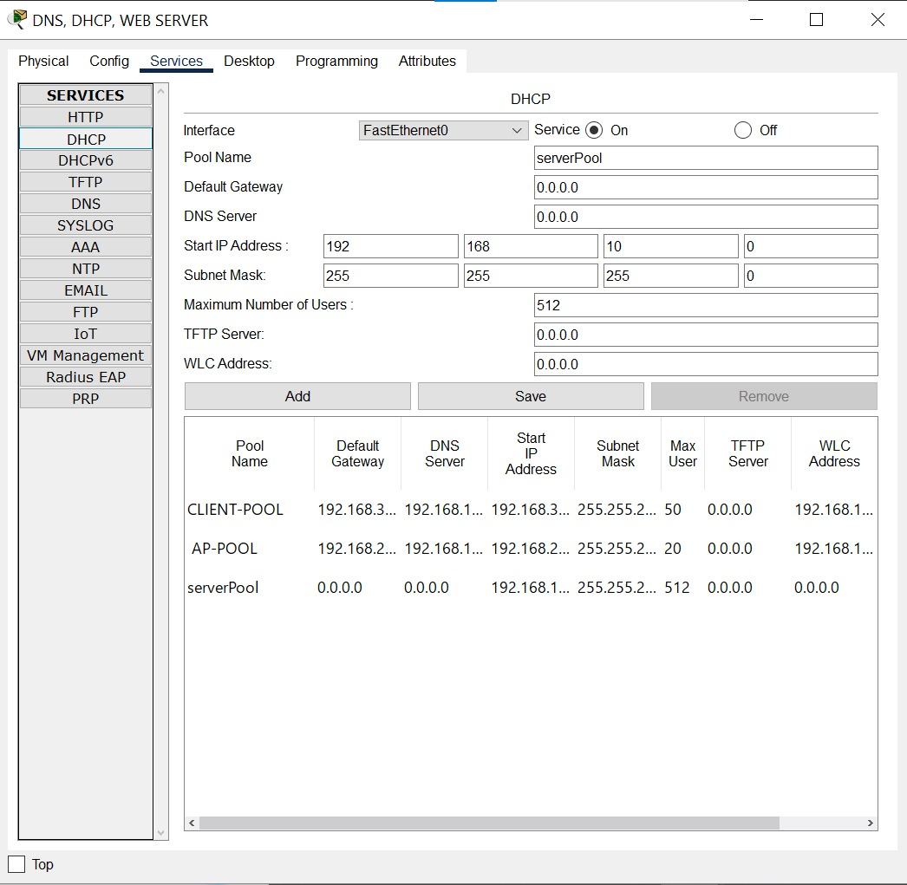

**WLC.** IP management, interface klien, dan WLAN.

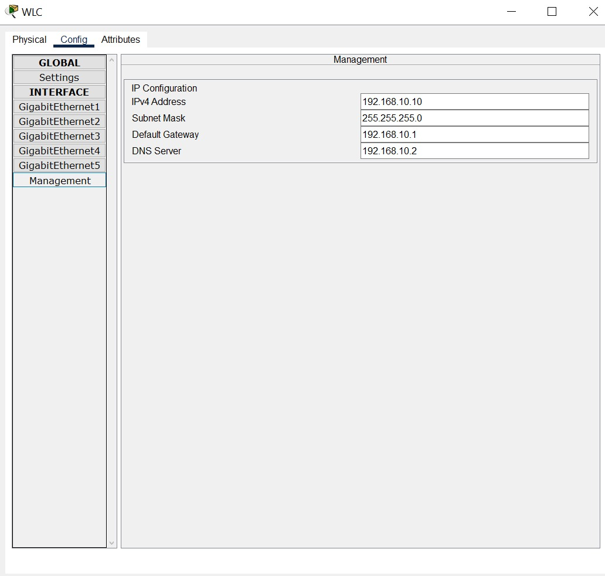

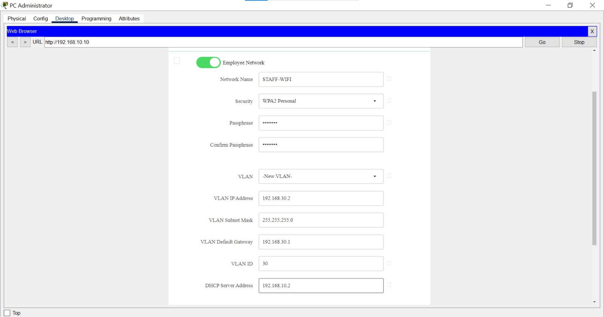

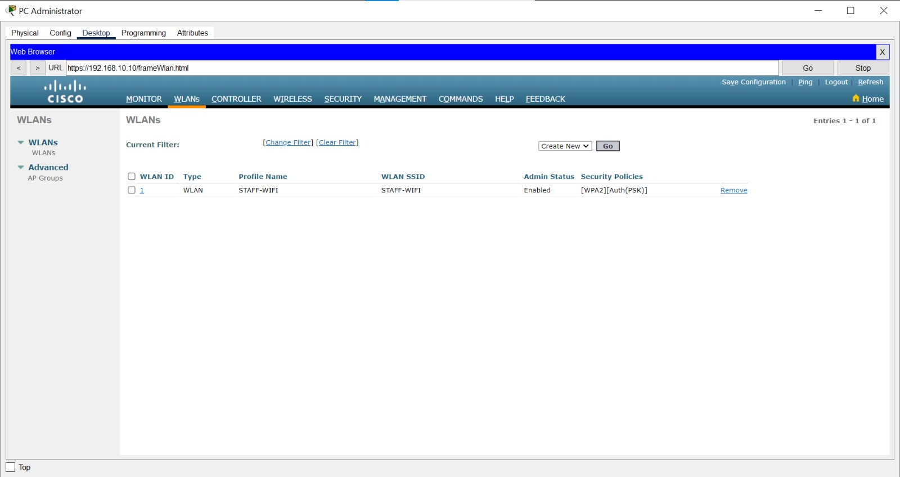

**Kedua AP terdaftar di WLC lewat CAPWAP.**

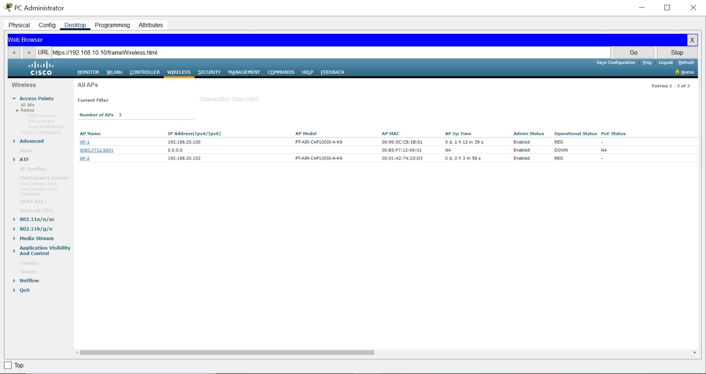

**Klien wireless.** Smartphone terhubung ke SSID dan mendapat IP dari VLAN 30.

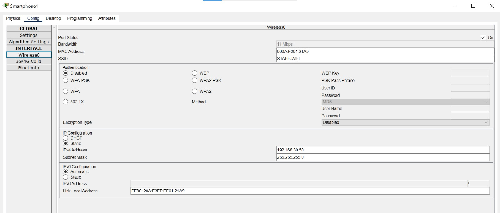

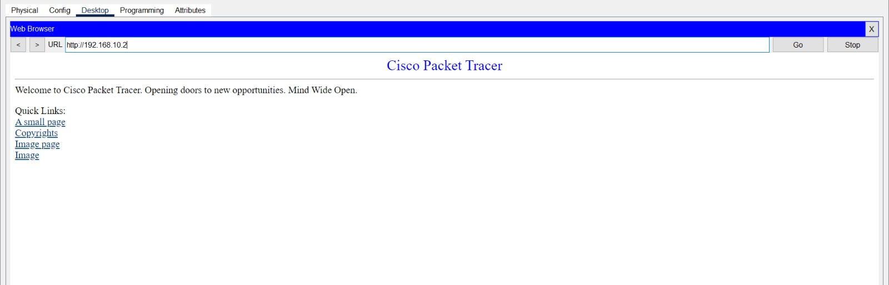

## 10. Troubleshooting

| Gejala | Kemungkinan penyebab | Pengecekan |
| --- | --- | --- |
| AP tidak muncul di WLC | AP belum dapat IP, atau WLC Controller IP belum diisi di pool | Cek pool AP-POOL, `ip helper-address` di VLAN 20 |
| GUI WLC tidak terbuka | IP management salah atau trunk Fa0/1 tidak sesuai | Ping 192.168.10.10 dari PC Administrator |
| Smartphone tidak dapat IP | WLAN belum Enabled, interface salah, atau relay VLAN 30 belum ada | Cek WLAN, `ip helper-address` di VLAN 30 |
| SSID tidak terlihat | AP belum join, atau SSID belum Enabled | Wireless > Access Points |
| Gagal autentikasi | Passphrase di WLAN dan smartphone berbeda | Samakan passphrase |

## 11. Yang dipelajari

- Lightweight AP tidak punya konfigurasi sendiri, semuanya diatur dari WLC lewat CAPWAP
- Satu SSID dipetakan ke satu VLAN lewat dynamic interface di WLC
- DHCP relay memungkinkan satu server melayani beberapa VLAN
- Gunakan WPA2 (AES) atau WPA3, jangan WEP atau TKIP

## 12. Pengembangan lanjutan

- Menambah WLAN tamu pada VLAN terpisah
- Autentikasi 802.1X dengan RADIUS untuk WPA2-Enterprise
- Mengatur channel 2,4 GHz (1, 6, 11) agar AP tidak saling mengganggu
