# Lab 06 - Routing: Static Route, Floating Static, OSPF, dan ACL

> Platform: Cisco Packet Tracer · Training CCNA 200-301 (ID-Networkers)
> File lab: `Routing.pkt`

## 1. Tujuan

Menghubungkan dua LAN lewat tiga router dengan tiga pendekatan, lalu membandingkannya:

- **Static route** beserta default route dan **floating static** sebagai cadangan
- **OSPF single area** yang menyesuaikan rute otomatis saat jalur putus
- **ACL** (standard dan extended) untuk membatasi trafik antar LAN

## 2. Topologi

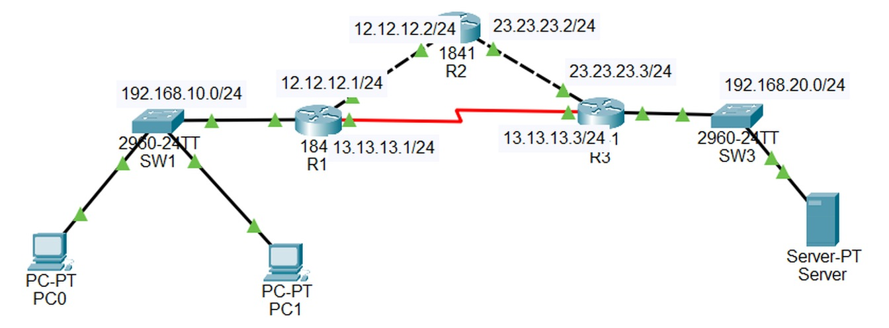

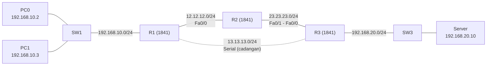

## 3. Tabel alamat

| Perangkat | Interface | IP address | Terhubung ke |
| --- | --- | --- | --- |
| R1 | Fa0/0 | 12.12.12.1/24 | R2 Fa0/0 |
| R1 | Fa0/1 | 192.168.10.1/24 | SW1 (LAN PC) |
| R1 | Se0/0/0 | 13.13.13.1/24 | R3 Se0/0/0 |
| R2 | Fa0/0 | 12.12.12.2/24 | R1 Fa0/0 |
| R2 | Fa0/1 | 23.23.23.2/24 | R3 Fa0/0 |
| R3 | Fa0/0 | 23.23.23.3/24 | R2 Fa0/1 |
| R3 | Fa0/1 | 192.168.20.1/24 | SW3 (LAN server) |
| R3 | Se0/0/0 | 13.13.13.3/24 | R1 Se0/0/0 (sisi DCE, `clock rate 64000`) |
| PC0 | NIC | 192.168.10.2/24, gateway 192.168.10.1 | SW1 |
| PC1 | NIC | 192.168.10.3/24, gateway 192.168.10.1 | SW1 |
| Server | NIC | 192.168.20.10/24, gateway 192.168.20.1 | SW3 |

## 4. Konsep singkat

| Konsep | Penjelasan |
| --- | --- |
| Connected route (C) | Dibuat otomatis saat interface aktif diberi IP |
| Static route (S) | Dibuat manual: `ip route <network> <mask> <next-hop>` |
| Default route | `0.0.0.0 0.0.0.0`, menampung semua tujuan yang tidak dikenal |
| Floating static | Static route cadangan dengan AD lebih tinggi. Baru dipakai jika rute utama hilang |
| Administrative distance | Tingkat kepercayaan sumber rute. Static = 1, OSPF = 110 |
| Longest prefix match | Router memilih rute dengan prefix paling panjang yang cocok |
| OSPF | Link-state, open standard, metric berupa cost. Cost = reference bandwidth (100 Mbps) dibagi bandwidth interface |

Cost OSPF: FastEthernet = 1, serial 1,544 Mbps = 64.

## 5. Bagian A: Static route

**Konfigurasi:** [`configs/01-static/`](configs/01-static/) (R1, R2, R3).

```
! R1
ip route 23.23.23.0 255.255.255.0 12.12.12.2
ip route 192.168.20.0 255.255.255.0 12.12.12.2

! R2
ip route 192.168.10.0 255.255.255.0 12.12.12.1
ip route 192.168.20.0 255.255.255.0 23.23.23.3

! R3
ip route 0.0.0.0 0.0.0.0 23.23.23.2
ip route 0.0.0.0 0.0.0.0 13.13.13.1 10
```

| Perintah | Fungsi |
| --- | --- |
| `ip route 192.168.20.0 255.255.255.0 12.12.12.2` (R1) | LAN server dicapai lewat R2 |
| `ip route 192.168.10.0 255.255.255.0 12.12.12.1` (R2) | Rute balik ke LAN PC. Static route harus dibuat dua arah |
| `ip route 0.0.0.0 0.0.0.0 23.23.23.2` (R3) | Default route utama lewat R2 |
| `ip route 0.0.0.0 0.0.0.0 13.13.13.1 10` (R3) | Floating static: cadangan lewat serial, AD 10 sehingga tidak dipakai selama rute utama ada |

**Rute di R1 dan R3.** R1 berisi route connected dan static, R3 berisi gateway of last resort lewat R2.

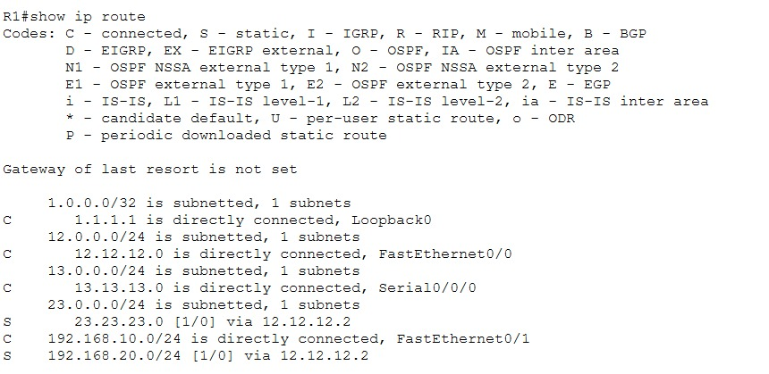

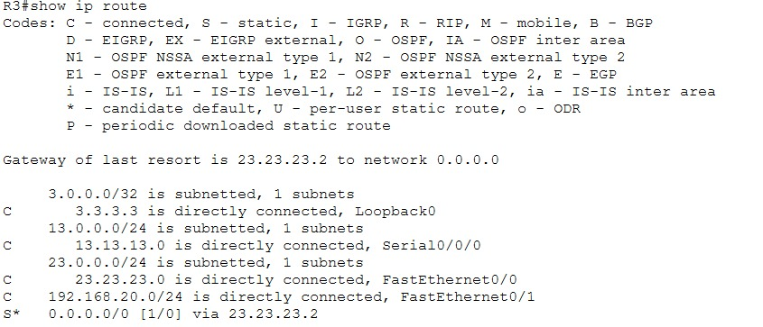

**Konektivitas.** Ping dari PC0 ke server, lalu traceroute yang menunjukkan jalur R1, R2, R3.

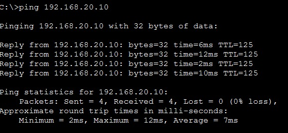

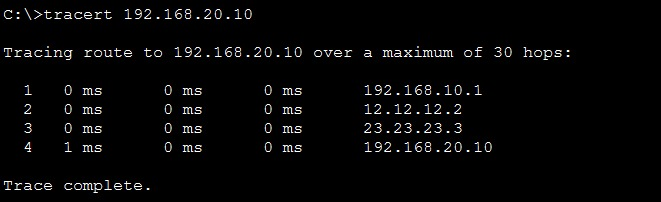

**Uji floating static.** Fa0/0 R3 dimatikan (`shutdown`). Default route utama hilang dan gateway of last resort di R3 berpindah ke 13.13.13.1 (serial).

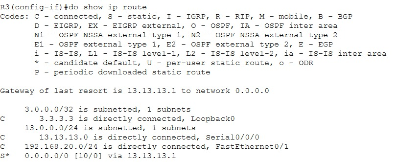

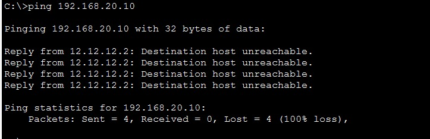

**Catatan penting.** Static route tidak mengetahui kegagalan pada router yang bukan tetangga langsungnya. R1 tetap mengirim ke R2 selama link R1-R2 masih hidup, walaupun R2 tidak lagi punya jalur ke R3. Failover end-to-end yang andal membutuhkan routing dinamis, yaitu bagian berikutnya. Setelah uji, aktifkan kembali Fa0/0 R3 dengan `no shutdown`.

## 6. Bagian B: OSPF single area

**Konfigurasi:** [`configs/02-ospf/`](configs/02-ospf/). Static route dihapus lebih dulu, lalu loopback dibuat sebagai Router-ID.

```
router ospf 1
 network 12.12.12.0 0.0.0.255 area 0
 network 13.13.13.0 0.0.0.255 area 0
 network 192.168.10.0 0.0.0.255 area 0
 network 1.1.1.1 0.0.0.0 area 0
 passive-interface fa0/1
```

| Perintah | Fungsi |
| --- | --- |
| `network 12.12.12.0 0.0.0.255 area 0` | Mengaktifkan OSPF pada interface yang cocok dengan network dan wildcard |
| `network 1.1.1.1 0.0.0.0 area 0` | Wildcard 0.0.0.0 mencocokkan satu IP persis, cocok untuk loopback |
| `passive-interface fa0/1` | Interface LAN tetap di-advertise tetapi tidak mengirim Hello |
| `interface loopback 0` | Router-ID otomatis diambil dari IP loopback tertinggi |

**Tetangga OSPF.** R1 punya dua neighbor (R2 dan R3) dengan state FULL.

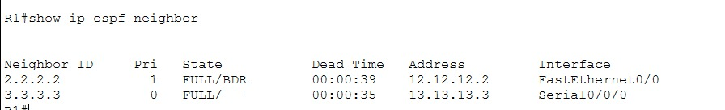

**Routing table.** Rute berkode O muncul untuk network yang dipelajari lewat OSPF.

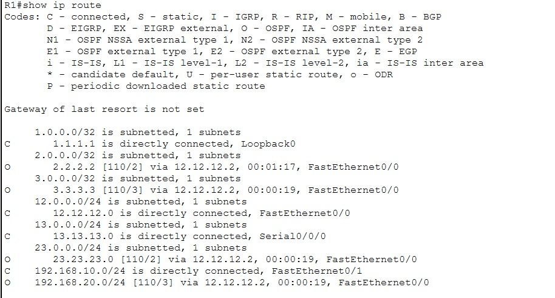

**Interface OSPF.** Fa0/0 bertipe BROADCAST dengan cost 1 dan memilih DR/BDR. Serial bertipe POINT-TO-POINT dengan cost 64 dan tanpa DR/BDR.

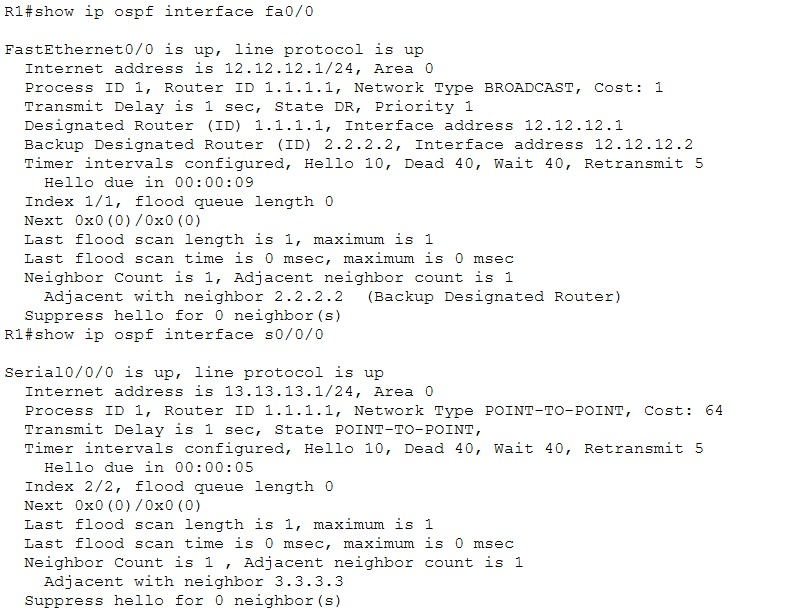

**Uji failover.** Fa0/0 R3 dimatikan. OSPF menghitung ulang, rute ke LAN server berpindah lewat serial, dan ping tetap berhasil.

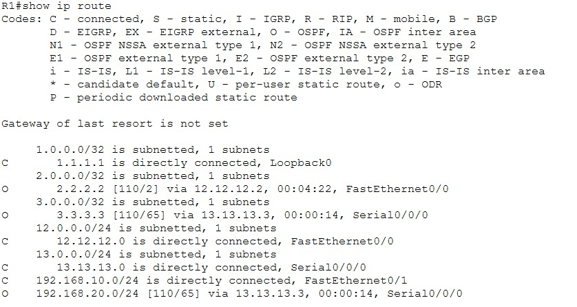

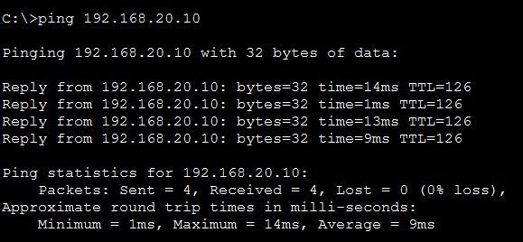

**Activity.** Mengubah cost dan tipe network, serta reference bandwidth, ada di [`activity-cost-dan-network-type.txt`](configs/02-ospf/activity-cost-dan-network-type.txt). Tipe network harus sama di dua ujung link, dan reference bandwidth harus sama di semua router.

## 7. Bagian C: ACL

**Konfigurasi:** [`configs/03-acl/ACL.txt`](configs/03-acl/ACL.txt).

| Skenario | Jenis | Lokasi | Tujuan |
| --- | --- | --- | --- |
| 1 | Standard | R3 Fa0/1 out | Blokir LAN PC ke LAN server |
| 2 | Standard (sisipan baris 5) | R3 Fa0/1 out | Izinkan hanya host 192.168.10.2 |
| 3 | Standard (`access-class`) | R3 VTY | SSH ke R3 hanya dari 192.168.10.2 |
| 4 | Extended | R1 Fa0/1 in | Blokir web, FTP, dan ping dari LAN PC ke server |

Pedoman: standard ACL dipasang dekat **tujuan**, extended ACL dekat **sumber**. ACL dibaca dari atas, dan semua ACL berakhir dengan implicit deny any.

**Standard ACL.** Isi ACL dan hitungan match-nya.

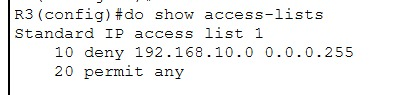

**Ping dari PC0 ke server diblokir** (Destination host unreachable), sedangkan ping dari router tetap berhasil.

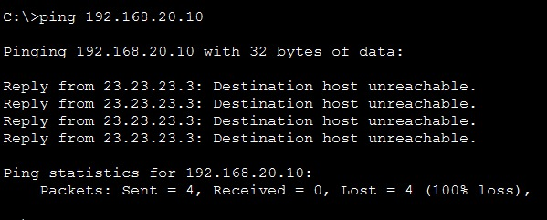

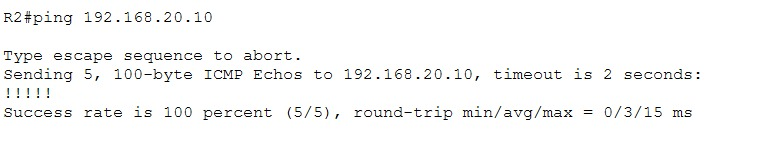

## 8. Troubleshooting

| Gejala | Kemungkinan penyebab | Pengecekan |
| --- | --- | --- |
| Ping ke server gagal setelah static route | Rute balik belum dibuat di salah satu router | `show ip route` di semua router |
| Neighbor OSPF tidak muncul | Area, hello atau dead interval berbeda, atau network tidak ter-advertise | `show ip ospf interface`, `show ip protocols` |
| Neighbor stuck di EXSTART | Tipe network atau MTU tidak sesuai | Samakan tipe network di kedua ujung |
| Interface serial down | Sisi DCE belum diberi `clock rate` | `show controllers s0/0/0` |
| Semua trafik terblokir ACL | `permit any` atau `permit ip any any` tertinggal | `show access-lists` |
| ACL tidak berefek | Dipasang di arah atau interface yang salah | `show ip interface fa0/1` |

## 9. Yang dipelajari

- Static route sederhana dan prediktif, tetapi harus dibuat dua arah dan tidak menyesuaikan diri terhadap kegagalan jauh
- Floating static memberi cadangan lewat AD yang lebih tinggi
- OSPF membangun tetangga, bertukar link-state, lalu menghitung jalur terpendek dengan cost
- Interface pasif mencegah Hello keluar ke LAN pengguna
- ACL standard dekat tujuan, extended dekat sumber, dibaca dari atas, dan ada implicit deny

## 10. Pengembangan lanjutan

- OSPF multi-area dengan ABR
- Autentikasi OSPF (message-digest)
- Default route yang diinjeksi ke OSPF (`default-information originate`)
- ACL bernama dengan logging (`log`)
