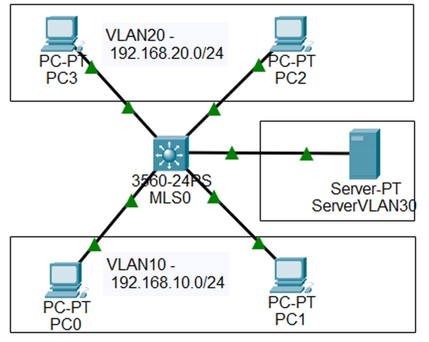
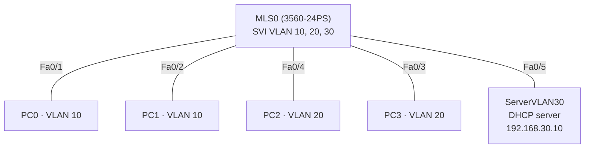
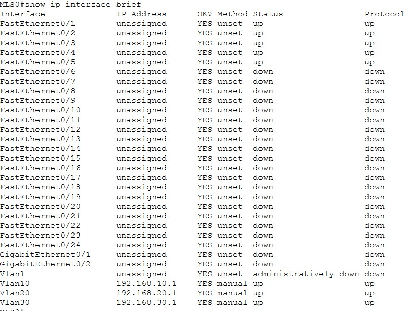
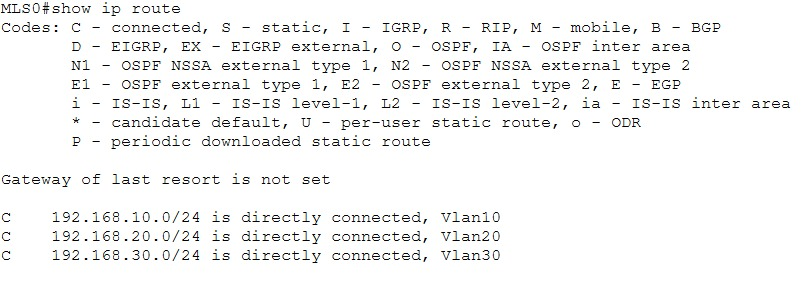
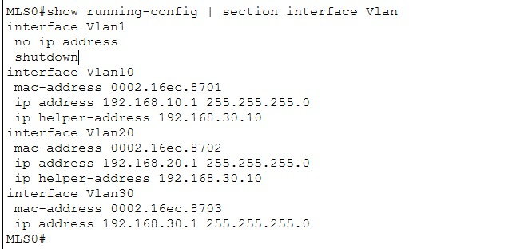
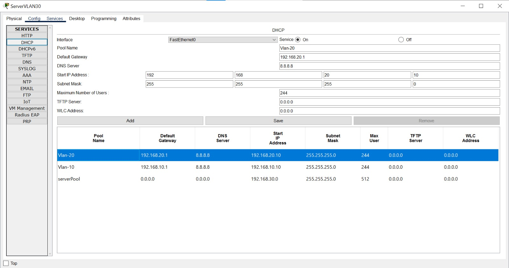
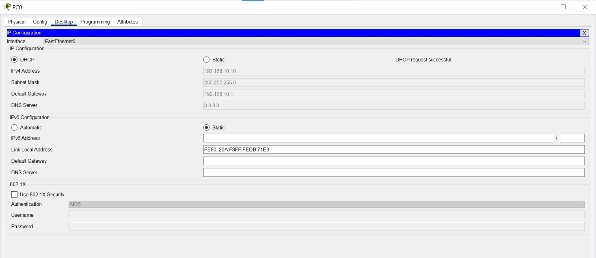
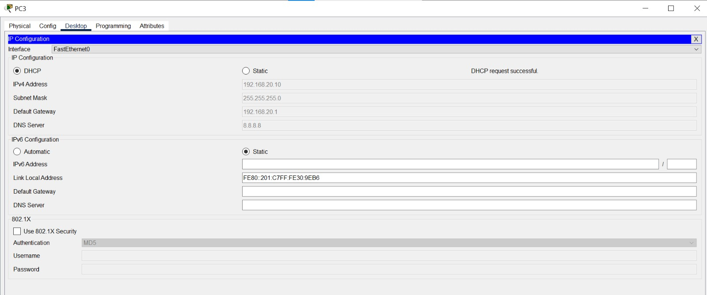
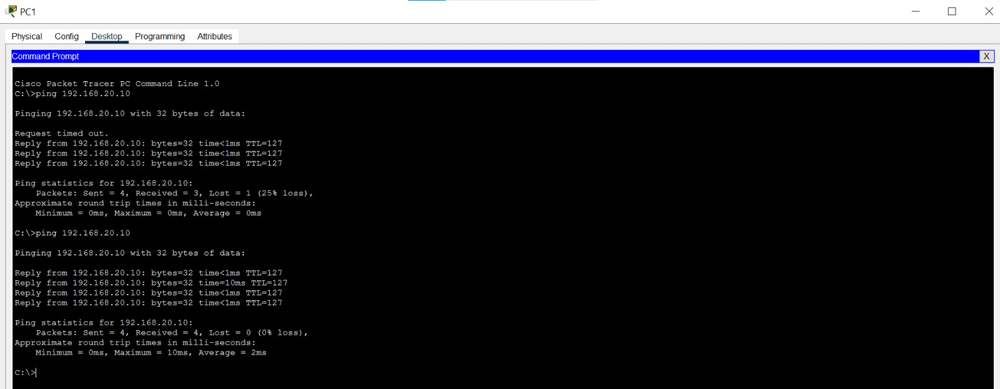
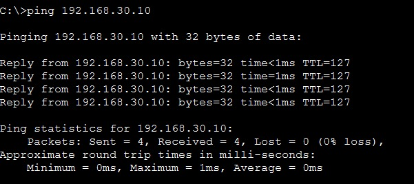

# Lab 07 - InterVLAN Routing dengan Multilayer Switch dan DHCP Relay

> Platform: Cisco Packet Tracer · Training CCNA 200-301 (ID-Networkers)
> File lab: `InterVLAN-MLS-DHCP.pkt`

## 1. Tujuan

- Merutekan trafik antar VLAN langsung di **multilayer switch (MLS)** memakai **SVI**, tanpa router terpisah
- Membagikan IP otomatis ke dua VLAN dari **satu DHCP server** yang berada di VLAN lain, dengan **DHCP relay** (`ip helper-address`)

## 2. Topologi





## 3. Tabel VLAN dan alamat

| VLAN | Nama | Network | Gateway (SVI di MLS0) | Host |
| --- | --- | --- | --- | --- |
| 10 | VLAN10 | 192.168.10.0/24 | 192.168.10.1 | PC0, PC1 (DHCP) |
| 20 | VLAN20 | 192.168.20.0/24 | 192.168.20.1 | PC2, PC3 (DHCP) |
| 30 | SERVER-VLAN30 | 192.168.30.0/24 | 192.168.30.1 | ServerVLAN30 (statis 192.168.30.10) |

| Pool DHCP | Gateway | DNS | Start IP |
| --- | --- | --- | --- |
| Vlan-10 | 192.168.10.1 | 8.8.8.8 | 192.168.10.10 |
| Vlan-20 | 192.168.20.1 | 8.8.8.8 | 192.168.20.10 |

## 4. Pemetaan port

| Port MLS0 | Terhubung ke | VLAN |
| --- | --- | --- |
| Fa0/1 | PC0 | 10 |
| Fa0/2 | PC1 | 10 |
| Fa0/3 | PC3 | 20 |
| Fa0/4 | PC2 | 20 |
| Fa0/5 | ServerVLAN30 | 30 |

## 5. Konsep singkat

| Metode inter-VLAN | Cara kerja | Catatan |
| --- | --- | --- |
| Legacy | Satu interface router per VLAN | Boros port |
| Router on a stick | Satu trunk ke router, subinterface per VLAN | Satu link menjadi bottleneck |
| **Multilayer switch** | SVI per VLAN, routing di switch | Cepat dan umum di kantor. Dipakai di lab ini |

**DHCP (DORA):** Discover (broadcast), Offer, Request, Acknowledge. Client memakai UDP 68, server UDP 67. Broadcast tidak melewati VLAN lain, sehingga server di VLAN 30 butuh **relay** di SVI VLAN 10 dan 20. Relay meneruskan Discover sebagai unicast ke server dan mencantumkan IP SVI-nya, sehingga server tahu pool mana yang harus dipakai.

## 6. Langkah pengerjaan

1. Buat VLAN 10, 20, 30 di MLS0
2. Aktifkan `ip routing` dan buat SVI tiap VLAN sebagai gateway
3. Pasang port host sebagai access port sesuai VLAN-nya
4. Pasang `ip helper-address` di SVI VLAN 10 dan 20
5. Atur IP statis server, aktifkan DHCP server dan buat pool per VLAN
6. Ubah PC menjadi DHCP, lalu uji ping antar VLAN dan ke server

## 7. Konfigurasi

Folder [`configs/`](configs/):

- [`MLS0.txt`](configs/MLS0.txt): konfigurasi CLI MLS
- [`DHCP-server.txt`](configs/DHCP-server.txt): pool di server
- [`IP-hosts.txt`](configs/IP-hosts.txt): IP server dan host
- [`alternatif-dhcp-di-mls.txt`](configs/alternatif-dhcp-di-mls.txt): pilihan lain, MLS sebagai DHCP server

Perintah inti:

```
ip routing
interface vlan 10
 ip address 192.168.10.1 255.255.255.0
 ip helper-address 192.168.30.10
 no shutdown
```

## 8. Penjelasan

| Perintah | Fungsi |
| --- | --- |
| `ip routing` | Mengaktifkan routing Layer 3. Tanpa ini SVI tidak merutekan antar VLAN |
| `interface vlan 10` + `ip address ...` | SVI VLAN 10, menjadi default gateway host di VLAN 10 |
| `no shutdown` | Menghidupkan SVI. SVI naik jika VLAN-nya ada dan ada port aktif di VLAN itu |
| `ip helper-address 192.168.30.10` | DHCP relay: broadcast DHCP client diteruskan sebagai unicast ke server di VLAN 30 |
| `switchport access vlan 10` | Menempatkan port host ke VLAN 10 |
| Pool per VLAN di server | Server memilih pool sesuai network IP SVI yang dicantumkan relay |

## 9. Verifikasi

**VLAN dan SVI.** VLAN 10, 20, 30 aktif dan SVI-nya up/up.




**Routing table.** Tiga route connected, satu untuk tiap SVI.



**DHCP relay terpasang di SVI VLAN 10 dan 20.**



**Pool DHCP di server.**



**Client memperoleh IP otomatis** (gateway sesuai SVI, DNS 8.8.8.8).





**Konektivitas.** Ping antar VLAN (VLAN 10 ke VLAN 20) dan ke server di VLAN 30.





## 10. Troubleshooting

| Gejala | Kemungkinan penyebab | Pengecekan |
| --- | --- | --- |
| PC mendapat 169.254.x.x (APIPA) | Relay belum ada, atau pool untuk VLAN itu belum dibuat | `ip helper-address` di SVI, pool di server |
| SVI down | VLAN belum dibuat, atau tidak ada port aktif di VLAN itu | `show vlan brief`, `show ip interface brief` |
| Ping antar VLAN gagal | `ip routing` belum aktif | `show ip route` |
| PC dapat IP dari VLAN lain | Port masuk VLAN yang salah | `show vlan brief` |
| Server tidak terjangkau | IP server atau gateway salah | `ipconfig` di server |

## 11. Yang dipelajari

- SVI memungkinkan satu switch merutekan banyak VLAN dengan cepat
- Broadcast tidak melewati VLAN, jadi DHCP lintas VLAN butuh relay
- Server DHCP memilih pool dari alamat SVI yang dicantumkan relay, sehingga satu server cukup untuk banyak VLAN
- Gateway ada di satu MLS, sehingga ini titik tunggal kegagalan (lihat Lab 01 untuk redundansi dengan HSRP)

## 12. Pengembangan lanjutan

- DHCP snooping agar server DHCP palsu tidak bisa membagikan IP (`ip dhcp snooping`)
- `ip dhcp excluded-address` untuk melindungi IP statis dari pembagian
- Port security pada port host
- Mengamankan antar VLAN dengan ACL pada SVI
