# Lab 08 - NAT (PAT, Static NAT, Static PAT) dan GRE Tunnel

> Platform: Cisco Packet Tracer · Training CCNA 200-301 (ID-Networkers)
> File lab: `NAT-GRE.pkt`

## 1. Tujuan

- **PAT (NAT overload):** banyak PC di jaringan private berbagi satu IP publik untuk keluar ke "internet"
- **Static NAT dan Static PAT:** server di jaringan private bisa diakses dari luar lewat alamat publik
- **GRE tunnel:** menghubungkan dua LAN private lewat jaringan publik seperti dengan satu kabel virtual, padahal router ISP tidak punya rute ke jaringan private

## 2. Topologi

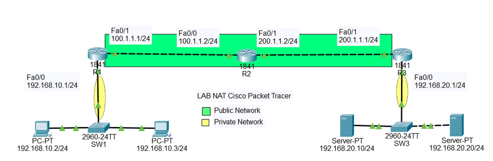

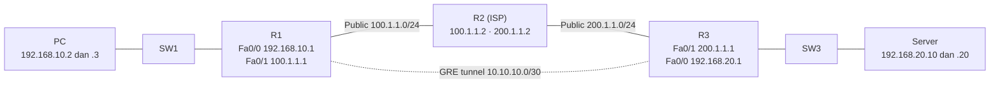

## 3. Tabel alamat

| Perangkat | Interface | IP address | Keterangan |
| --- | --- | --- | --- |
| R1 | Fa0/0 | 192.168.10.1/24 | Private, NAT inside |
| R1 | Fa0/1 | 100.1.1.1/24 | Public, NAT outside |
| R1 | Tunnel0 | 10.10.10.1/30 | Ujung tunnel, source Fa0/1, destination 200.1.1.1 |
| R2 | Fa0/0 | 100.1.1.2/24 | ISP, ke R1 |
| R2 | Fa0/1 | 200.1.1.2/24 | ISP, ke R3 |
| R3 | Fa0/1 | 200.1.1.1/24 | Public, NAT outside |
| R3 | Fa0/0 | 192.168.20.1/24 | Private, NAT inside |
| R3 | Tunnel0 | 10.10.10.2/30 | Ujung tunnel, source Fa0/1, destination 100.1.1.1 |
| PC | NIC | 192.168.10.2 dan .3 /24 | Gateway 192.168.10.1 |
| Server | NIC | 192.168.20.10 dan .20 /24 | Gateway 192.168.20.1 |

Daftar IP statis host ada di [`configs/IP-hosts.txt`](configs/IP-hosts.txt).

## 4. Konsep singkat

| Istilah NAT | Arti pada lab ini |
| --- | --- |
| Inside local | IP host di dalam sebelum diterjemahkan, misalnya 192.168.10.2 |
| Inside global | IP host di dalam setelah diterjemahkan, misalnya 100.1.1.1 |
| NAT inside / outside | Penanda interface sisi LAN dan sisi ISP. NAT hanya berjalan jika keduanya ditandai |

| Jenis NAT | Pemetaan | Dipakai di lab |
| --- | --- | --- |
| Static NAT | 1 IP private ke 1 IP publik | Server .20 menjadi 200.1.1.1 |
| Static PAT | 1 IP:port ke 1 IP:port | Server .10 port 443 menjadi 200.1.1.5 port 4443 |
| Dynamic NAT | N ke N dari pool | Tidak dipakai |
| PAT (overload) | N ke 1, dibedakan nomor port | Semua PC menjadi 100.1.1.1 |

| | Tunnel | VPN |
| --- | --- | --- |
| Server dan client | Tidak ada | Ada |
| IP publik | Statik di kedua sisi | Statik hanya di sisi server |
| Cakupan | Site-to-site | Site-to-site dan remote access |
| Enkripsi | Umumnya tidak ada (GRE tidak mengenkripsi) | Umumnya ada |

GRE membungkus paket asli dengan header GRE dan header IP baru (IP protocol 47), sehingga router ISP hanya melihat alamat publik 100.1.1.1 dan 200.1.1.1. Untuk keamanan, GRE biasanya digabung dengan IPsec.

## 5. Langkah pengerjaan

1. Atur IP semua interface dan host sesuai tabel
2. Pasang default route di R1 dan R3 ke ISP (R2)
3. Konfigurasi PAT di R1, lalu uji akses dari PC ke ISP
4. Konfigurasi static NAT dan static PAT di R3, lalu cek tabel translasi
5. Buat GRE tunnel di R1 dan R3, beri IP tunnel, dan tambahkan rute ke LAN seberang lewat tunnel
6. Uji PC ke server lewat tunnel, bandingkan dengan jalur tanpa tunnel

## 6. Konfigurasi

Folder [`configs/`](configs/): [`R1.txt`](configs/R1.txt), [`R2.txt`](configs/R2.txt), [`R3.txt`](configs/R3.txt), [`IP-hosts.txt`](configs/IP-hosts.txt).

Perintah inti:

```
! R1 - PAT
access-list 1 permit 192.168.10.0 0.0.0.255
ip nat inside source list 1 interface fa0/1 overload

! R3 - static NAT dan static PAT
ip nat inside source static 192.168.20.20 200.1.1.1
ip nat inside source static tcp 192.168.20.10 443 200.1.1.5 4443

! R1 - GRE tunnel
interface tunnel 0
 tunnel source fa0/1
 tunnel destination 200.1.1.1
 ip address 10.10.10.1 255.255.255.252
ip route 192.168.20.0 255.255.255.0 10.10.10.2
```

## 7. Penjelasan

| Perintah | Fungsi |
| --- | --- |
| `ip nat inside` / `ip nat outside` | Menandai sisi LAN dan sisi ISP |
| `access-list 1 permit 192.168.10.0 0.0.0.255` | Menentukan network yang boleh di-NAT (wildcard) |
| `ip nat inside source list 1 interface fa0/1 overload` | PAT: sumber cocok ACL 1 diterjemahkan ke IP Fa0/1, dibedakan oleh nomor port |
| `ip nat inside source static 192.168.20.20 200.1.1.1` | Static NAT 1 banding 1 |
| `ip nat inside source static tcp 192.168.20.10 443 200.1.1.5 4443` | Static PAT: akses ke 200.1.1.5 port 4443 diteruskan ke server port 443 |
| `ip route 0.0.0.0 0.0.0.0 100.1.1.2` | Default route ke ISP |
| `interface tunnel 0` | Interface virtual untuk tunnel |
| `tunnel source fa0/1` | Interface fisik (IP publik) pengirim tunnel |
| `tunnel destination 200.1.1.1` | IP publik router di ujung lawan |
| `ip address 10.10.10.1 255.255.255.252` | IP private "kabel virtual". /30 karena hanya dua ujung |
| `ip route 192.168.20.0 255.255.255.0 10.10.10.2` | LAN seberang dicapai lewat ujung tunnel |

## 8. Verifikasi

### Bagian A: NAT

**ISP tidak memiliki rute ke jaringan private.** Hanya network 100.1.1.0/24 dan 200.1.1.0/24 yang dikenal R2. Karena itu paket private tidak bisa dikirim langsung lewat ISP dan butuh NAT atau tunnel.

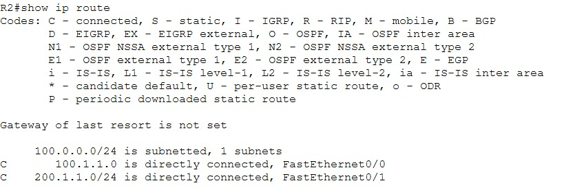

**PAT.** PC dapat menjangkau ISP walau IP-nya private.

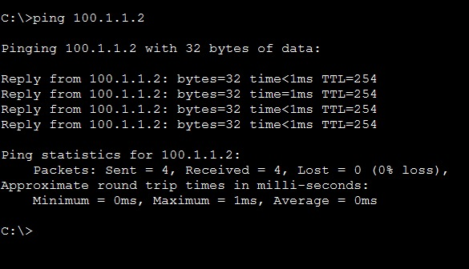

**Tabel translasi di R1.** IP private PC diterjemahkan ke 100.1.1.1, dibedakan oleh nomor port.

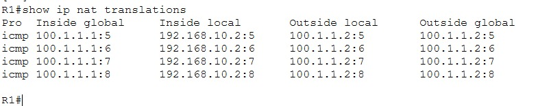

**Static NAT dan static PAT di R3.**

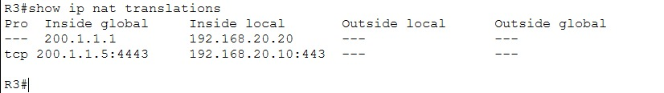

### Bagian B: GRE tunnel

**Status tunnel.** Up/up dengan source dan destination sesuai rencana.

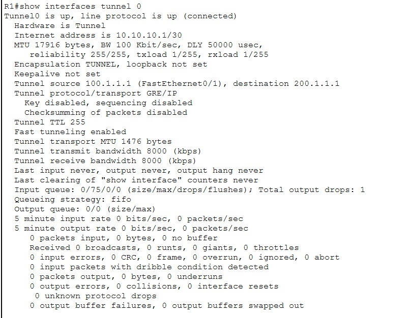

**Rute ke LAN seberang lewat tunnel.**

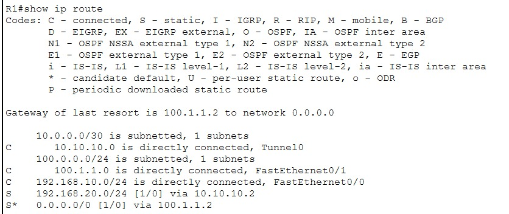

**Konektivitas end-to-end.** PC menjangkau server di LAN seberang.

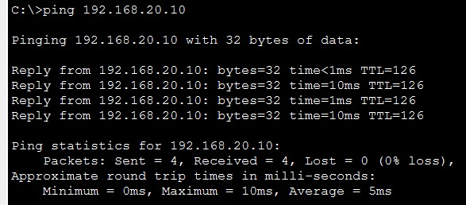

**Traceroute.** Hanya tiga hop: gateway, ujung tunnel R3 (10.10.10.2), lalu server. R2 tidak terlihat karena paket tunnel dibungkus dan dikirim sebagai satu lompatan.

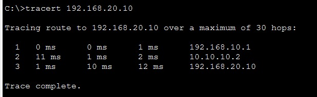

**Perbandingan paket (mode Simulation).** Paket yang lewat tunnel memiliki header luar dengan IP publik 100.1.1.1 dan 200.1.1.1 yang membungkus paket asli.

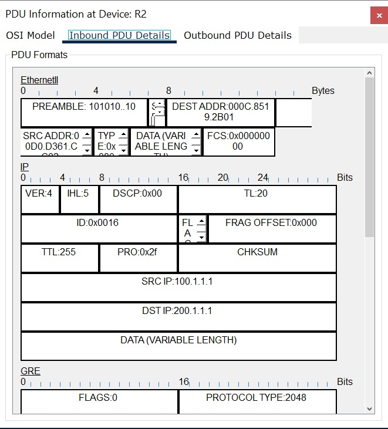

## 9. Troubleshooting

| Gejala | Kemungkinan penyebab | Pengecekan |
| --- | --- | --- |
| Tidak ada terjemahan | `ip nat inside` atau `outside` belum dipasang, atau ACL salah | `show ip nat statistics`, `show access-lists` (jumlah match) |
| PC tidak bisa ke ISP | Default route hilang | `show ip route`, ping dari router |
| Static NAT tidak bisa diakses dari luar | IP global tidak ada di network outside, atau rute balik tidak ada | `show ip nat translations` |
| Tunnel down | Tunnel source atau destination salah, atau jalur publik terputus | `show interfaces tunnel 0`, ping 200.1.1.1 dari R1 |
| Tunnel naik tetapi LAN seberang tidak terjangkau | Rute ke LAN seberang lewat tunnel belum ada | `show ip route` |
| Tunnel mati setelah static NAT dipasang di R3 | Alamat 200.1.1.1 dipakai sebagai IP global static NAT sekaligus ujung tunnel, sehingga lalu lintas ke alamat itu ikut diterjemahkan | Uji tunnel tanpa static NAT 200.1.1.1, atau pakai IP global lain |

## 10. Yang dipelajari

- NAT hanya bekerja jika sisi inside dan outside sudah ditandai, dan ACL NAT harus cocok dengan sumber yang diterjemahkan
- PAT memungkinkan banyak host berbagi satu IP publik, dibedakan oleh nomor port
- NAT bukan firewall, ia tidak otomatis memfilter trafik masuk
- GRE membuat "kabel virtual" antar dua router lewat jaringan publik, tetapi tidak mengenkripsi
- Dari sisi ISP, paket tunnel hanya terlihat sebagai trafik antara dua alamat publik

## 11. Pengembangan lanjutan

- Menambah **IPsec** di atas GRE agar paket terenkripsi (ESP mode tunnel)
- Menjalankan OSPF di atas tunnel
- NAT dinamis dengan pool (`ip nat pool`)
- ACL pada sisi outside untuk membatasi trafik masuk
