<p align="center">
  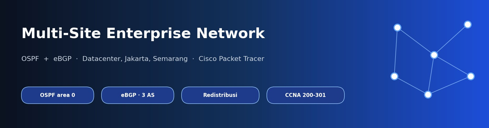
</p>

<p align="center">
  
  
  
  
</p>

# Super Lab: Jaringan Multi-Site dengan OSPF dan BGP

Tiga lokasi (**Datacenter, Jakarta, Semarang**) dihubungkan lewat satu ISP transit menjadi satu jaringan perusahaan yang saling terjangkau. **OSPF** mengatur rute di dalam tiap site, sedangkan **eBGP** menukar prefix antar site lewat ISP. Proyek ini menggabungkan hasil seluruh lab sebelumnya (VLAN, inter-VLAN, routing, OSPF, ACL) ke dalam satu topologi.

## Sorotan

| | |
| --- | --- |
| **3 site, 3 AS** | Datacenter AS 65100, Jakarta + Semarang AS 65200, ISP AS 65000 |
| **OSPF area 0 per site** | Datacenter, Jakarta, dan Semarang (Jakarta-Semarang lewat link serial) |
| **4 sesi eBGP** | Empat router border membuka peering ke satu ISP-Router |
| **Redistribusi BGP ke OSPF** | MLS dan router di dalam site mengetahui prefix site lain |
| **Peering ISP di VLAN 100** | Satu segmen 203.0.113.0/28 melalui switch distribusi ISP |
| **Kebijakan akses tetap berlaku** | ACL STAFF2-SRV dari Lab 06 tetap memblokir VLAN STAFF Semarang ke server Jakarta |

## Arsitektur

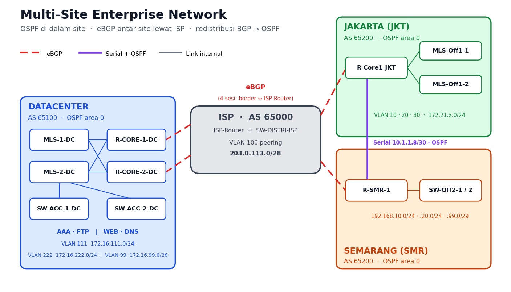

Topologi di Packet Tracer:

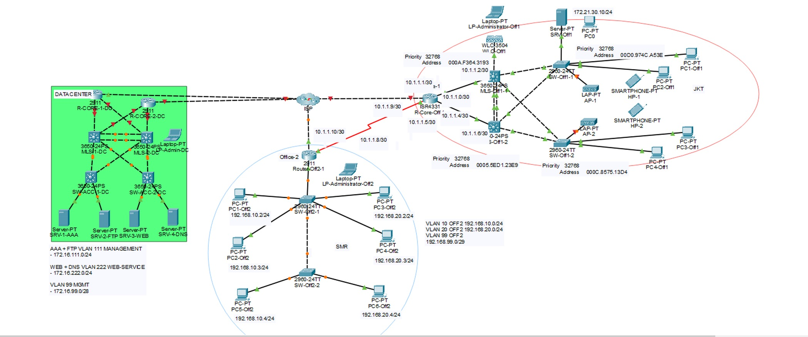

## Teknologi

| Area | Yang dipakai |
| --- | --- |
| Routing | OSPF (single area per site), eBGP, redistribusi BGP ke OSPF |
| Switching | VLAN, trunk, SVI di multilayer switch |
| Layanan | DHCP relay, server AAA, FTP, WEB, DNS |
| Keamanan | ACL standard pada MLS |
| Alat | Cisco Packet Tracer, CLI Cisco IOS |

## Cara kerja routing

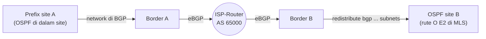

1. Di dalam site, OSPF menyebarkan semua rute, termasuk VLAN dan SVI
2. Border router mengiklankan prefix site-nya ke ISP lewat perintah `network` di BGP
3. ISP-Router meneruskan prefix itu ke border lain
4. Border menyebarkan rute BGP ke OSPF, sehingga MLS dan router di dalam site mengetahui jalan ke site lain

### Keputusan desain

| Keputusan | Alasan |
| --- | --- |
| Jakarta dan Semarang satu AS (65200) | Keduanya sudah terhubung langsung lewat link serial dan OSPF. Dengan AS yang sama, aturan AS-path loop prevention menolak prefix Semarang yang kembali dari ISP ke Jakarta, sehingga trafik antar office tetap lewat serial |
| `network` BGP untuk prefix site, bukan redistribusi OSPF ke BGP | Mencegah routing loop antara OSPF dan BGP |
| Link ISP tidak dimasukkan ke OSPF | Rute transit ISP tidak bocor ke jaringan site |
| Peering ISP pada VLAN 100 | Satu ISP-Router cukup menjadi speaker BGP untuk keempat border, tanpa mengubah subinterface lama |
| Loopback sebagai Router-ID | Identitas router stabil dan tidak bergantung pada interface fisik |

## Tabel alamat

### Segmen ISP (VLAN 100, 203.0.113.0/28)

| Perangkat | Interface | IP address | Terhubung ke |
| --- | --- | --- | --- |
| ISP-Router | Gig0/1.100 | 203.0.113.1/28 | SW-DISTRI-ISP Gig1/0/1 (trunk) |
| R-Core1-JKT | Gig0/0/0 | 203.0.113.2/28 | SW-DISTRI-ISP Gig1/0/2 |
| R-SMR-1 | Gig0/1 | 203.0.113.3/28 | SW-DISTRI-ISP Gig1/0/3 |
| R-CORE-1-DC | Gig0/0 | 203.0.113.4/28 | SW-DISTRI-ISP Gig1/0/4 |
| R-CORE-2-DC | Gig0/0 | 203.0.113.5/28 | SW-DISTRI-ISP Gig1/0/5 |

### Prefix LAN dan link internal

| Site | Prefix / link | Alamat |
| --- | --- | --- |
| DC | VLAN 111 (AAA, FTP), VLAN 222 (WEB, DNS), VLAN 99 (management) | 172.16.111.0/24, 172.16.222.0/24, 172.16.99.0/28 |
| DC | Link router core ke MLS | 10.2.1.0/30, 10.2.1.4/30, 10.2.1.8/30, 10.2.1.12/30 |
| DC | Loopback R-CORE-1-DC, R-CORE-2-DC | 10.0.1.1, 10.0.1.2 |
| JKT | VLAN 10, 20, 30 | 172.21.10.0/24, 172.21.20.0/24, 172.21.30.0/24 |
| JKT | Link router core ke MLS dan ke Semarang | 10.1.1.0/30, 10.1.1.4/30, 10.1.1.8/30 (serial) |
| SMR | VLAN 10, 20, 99 | 192.168.10.0/24, 192.168.20.0/24, 192.168.99.0/29 |
| JKT / SMR | Loopback | 10.0.0.1 sampai 10.0.0.4 |

## Hasil uji end-to-end

| No | Dari | Ke | Hasil |
| --- | --- | --- | --- |
| 1 | PC1-Off2 (SMR) | SRV-1-AAA 172.16.111.10 | ✅ Berhasil |
| 2 | PC1-Off1 (JKT) | SRV-4-DNS 172.16.222.11 | ✅ Berhasil |
| 3 | SRV-3-WEB (DC) | PC1-Off2 (SMR) | ✅ Berhasil |
| 4 | SRV-1-AAA (DC) | Server JKT 172.21.30.10 | ✅ Berhasil |
| 5 | PC1-Off1 (JKT) | PC1-Off2 (SMR) | ✅ Berhasil lewat serial (OSPF) |
| 6 | PC1-Off2 (SMR, VLAN 10) | Server JKT 172.21.30.10 | ✅ Diblokir, sesuai ACL STAFF2-SRV |
| 7 | LP-Admin-DC (VLAN 99) | Server JKT dan PC SMR | ✅ Berhasil |

## Bukti verifikasi

<details>
<summary><b>Fase 1: Segmen ISP dan konektivitas dasar</b></summary>

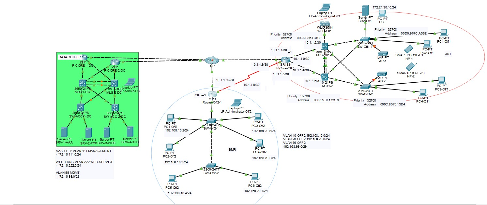

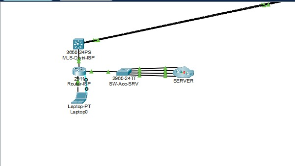

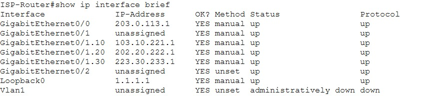

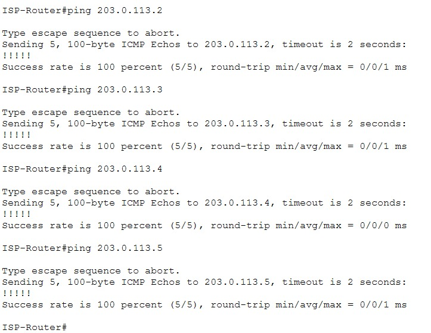

</details>

<details>
<summary><b>Fase 2: OSPF di tiap site</b></summary>

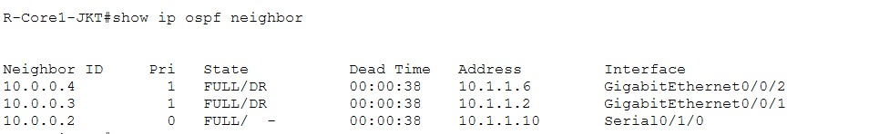

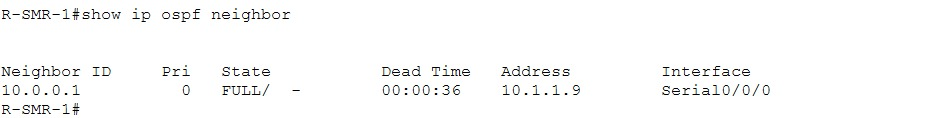

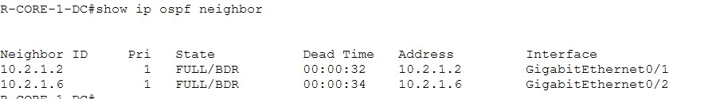

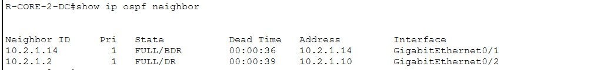

</details>

<details>
<summary><b>Fase 3 dan 4: eBGP dan pertukaran prefix</b></summary>

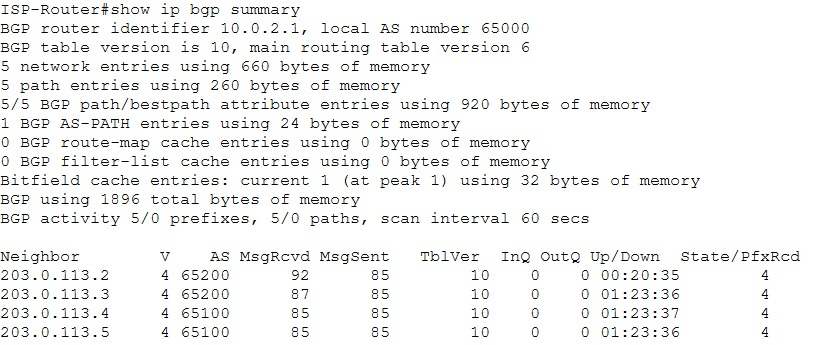

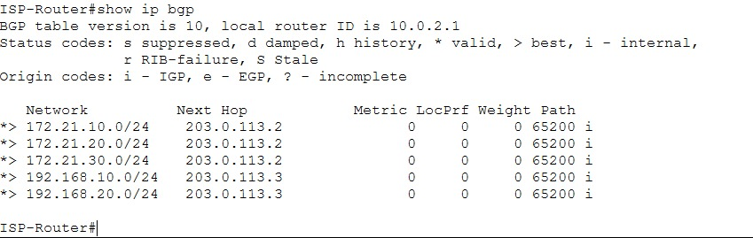

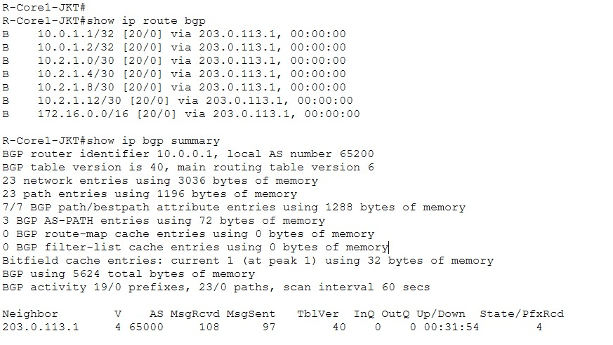

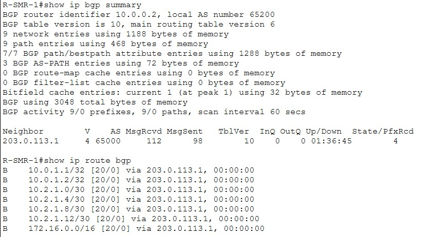

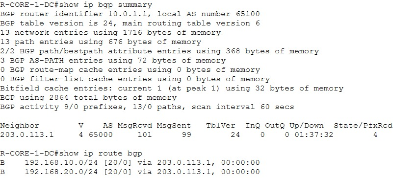

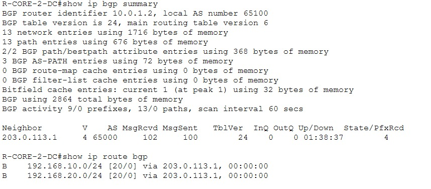

</details>

<details>
<summary><b>Fase 5: Redistribusi ke OSPF</b></summary>

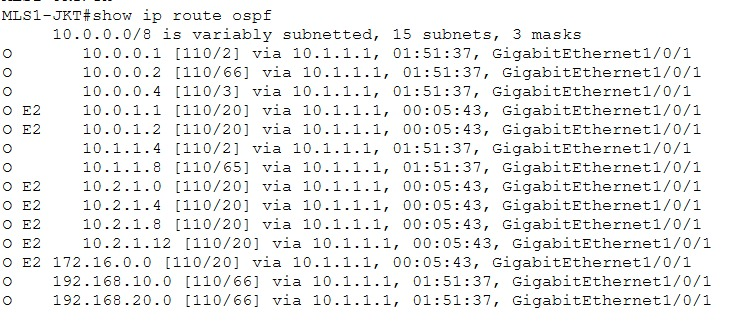

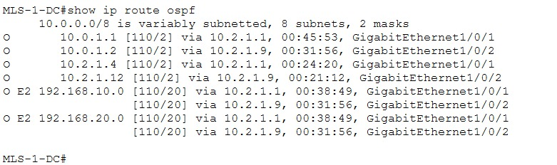

</details>

<details>
<summary><b>Fase 6: Uji end-to-end</b></summary>

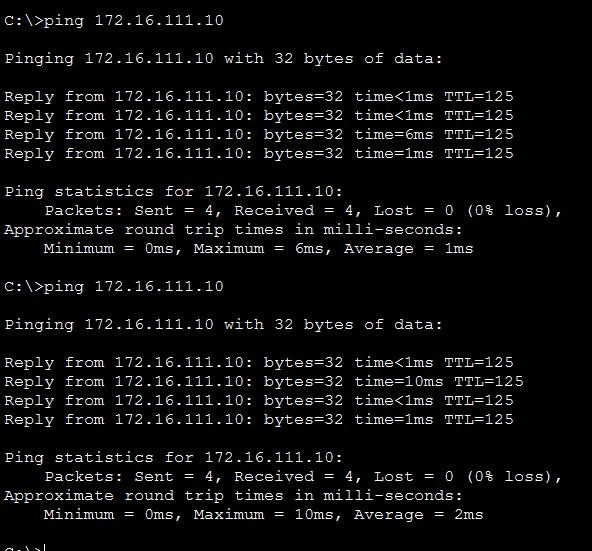

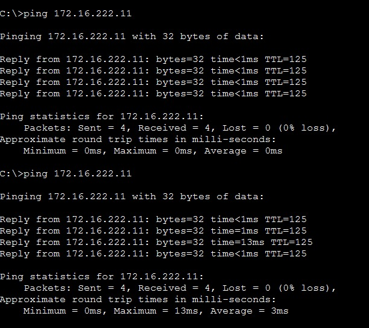

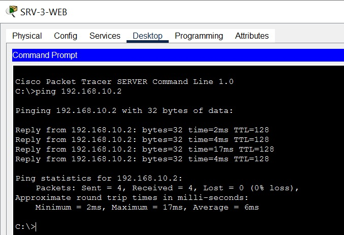

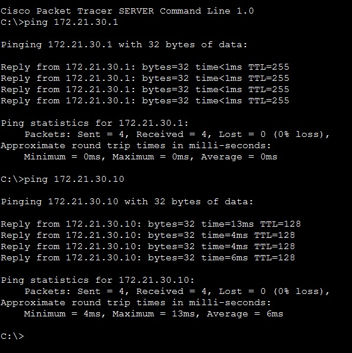

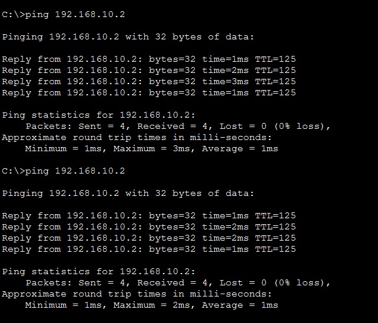

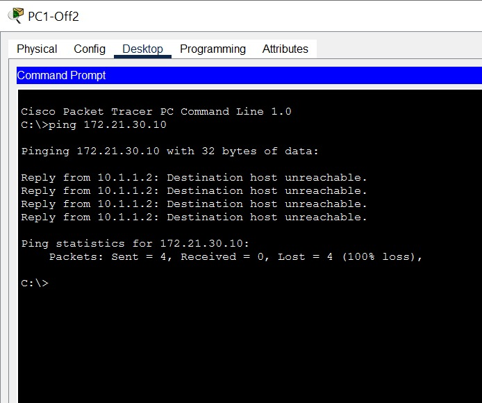

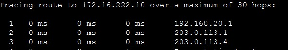

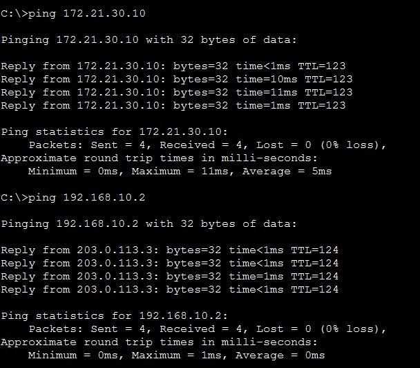

</details>

<details>
<summary><b>Uji redundansi</b></summary>


</details>

## Masalah yang ditemui dan solusinya

| Masalah | Cara menemukan | Solusi |
| --- | --- | --- |
| Router Datacenter tidak memiliki tetangga CDP | `show cdp neighbors` kosong di R-CORE-2-DC dan hanya satu tetangga di R-CORE-1-DC | Interface router mati secara default. Dinyalakan dengan `no shutdown`, karena CDP hanya menampilkan link yang up |
| ISP-Router tidak bisa ping border | `show cdp neighbors` di SW-DISTRI-ISP menunjukkan ISP-Router terhubung lewat **Gig0/1 ↔ Gig1/0/1**, bukan Gig0/0 yang menuju switch buntu | Alamat peering dipindah ke subinterface `Gig0/1.100`, VLAN 100 dibuat di SW-DISTRI-ISP, dan port ke empat border dijadikan access VLAN 100 |
| Pemetaan port topologi tidak jelas dari gambar | Gambar berlabel tumpang tindih | Seluruh port dipetakan dari hasil `show cdp neighbors` sebelum konfigurasi ditulis |

## Konfigurasi

Folder [`configs/`](configs/):

- [`ISP-Router.txt`](configs/ISP-Router.txt) · [`SW-DISTRI-ISP.txt`](configs/SW-DISTRI-ISP.txt)
- [`JKT-R-Core-Off-1.txt`](configs/JKT-R-Core-Off-1.txt) · [`SMR-RouterOff2-1.txt`](configs/SMR-RouterOff2-1.txt)
- [`DC-R-CORE-1-DC.txt`](configs/DC-R-CORE-1-DC.txt) · [`DC-R-CORE-2-DC.txt`](configs/DC-R-CORE-2-DC.txt)
- [`alternatif-default-route.txt`](configs/alternatif-default-route.txt): rencana cadangan jika redistribusi bermasalah
- [`verifikasi-per-fase.txt`](configs/verifikasi-per-fase.txt) · [`IP-hosts.txt`](configs/IP-hosts.txt)

Perintah inti pada router border:

```
router bgp 65200
 bgp router-id 10.0.0.1
 neighbor 203.0.113.1 remote-as 65000
 network 172.21.10.0 mask 255.255.255.0
router ospf 1
 redistribute bgp 65200 subnets
```

## Yang dipelajari

- Membedakan peran IGP (OSPF di dalam site) dan EGP (eBGP antar domain)
- Memetakan topologi dari fakta (`show cdp neighbors`) sebelum mengonfigurasi, bukan dari gambar
- Mencegah loop dengan `network` BGP, AS-path loop prevention, dan menjaga link ISP di luar OSPF
- Memecah pekerjaan besar menjadi fase yang diverifikasi satu per satu
- Mendokumentasikan hasil dengan bukti yang bisa diperiksa orang lain

## Pengembangan lanjutan

- iBGP antar dua border dalam satu AS dan HSRP di MLS Datacenter
- Failover Jakarta ke Semarang lewat ISP (butuh pengaturan AS-path atau distance agar tidak mengalahkan jalur serial)
- Autentikasi OSPF dan BGP, serta prefix-list pada sesi eBGP
- ACL per VLAN untuk membatasi akses ke server Datacenter
